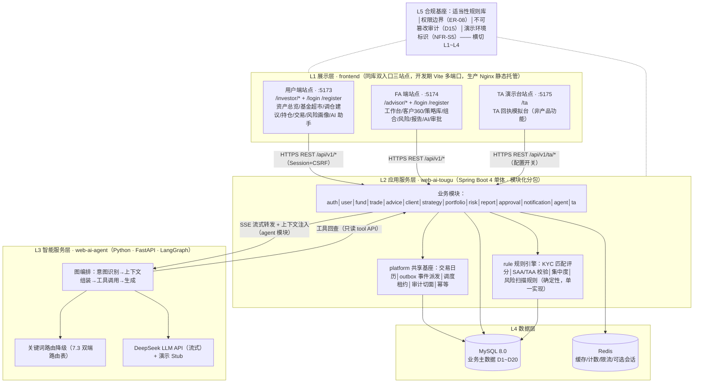
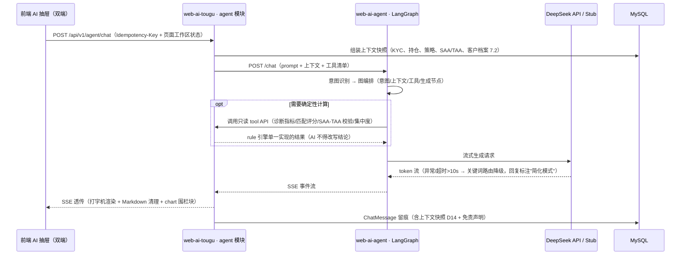
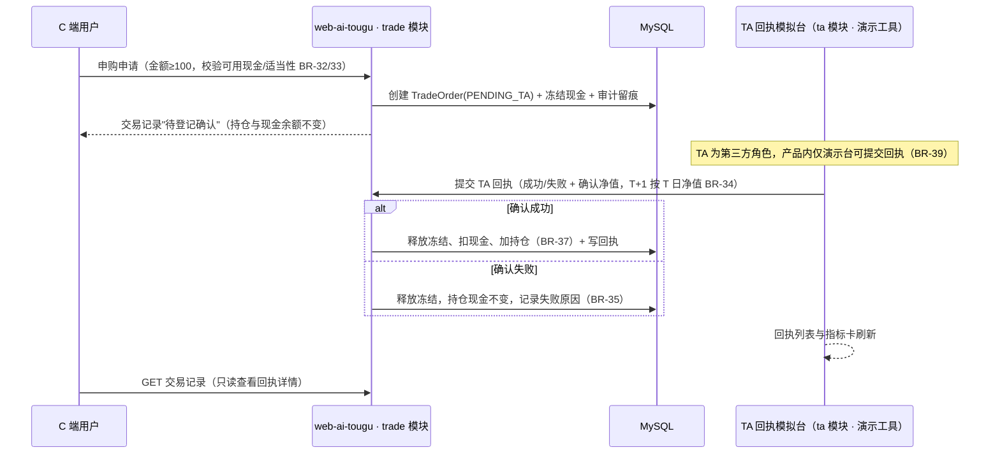
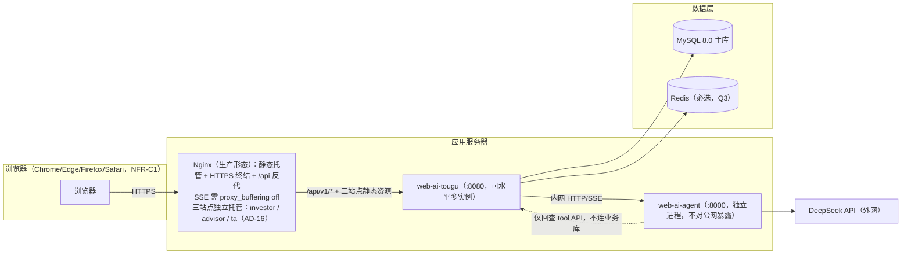
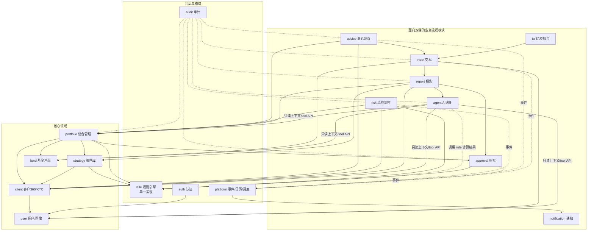
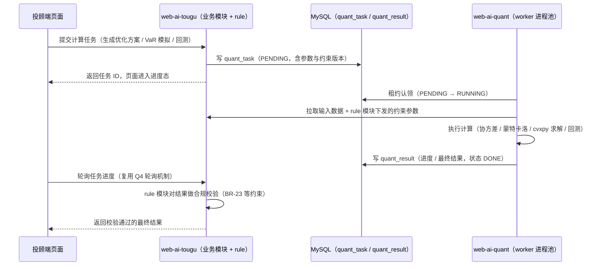

# FundPilot AI 基金投顾平台 · 项目架构设计

| | |
|---|---|
| **文档编号** | FP-ARCH-2026-002 |
| **产品名称** | FundPilot · AI 基金投顾平台（用户端 + FA 端 + TA 演示端） |
| **文档版本** | V1.6（回写端口拆分评审确认：前端同库双入口拆为三站点——用户端 :5173、FA 端 :5174、TA 演示台 :5175，登录/注册两端各自入口；其余同 V1.5） |
| **编写日期** | 2026-11-16 |
| **依据材料** | 《01.FundPilot_需求规格说明书》V1.8（下称"需求"）、`docs/prototype/` 三端原型、`CLAUDE.md` 工程规范、仓库 git 历史工程实践（m08 / F03 等批次） |
| **上一阶段** | 需求规格说明书 V1.8（TODO-16 等全部确认） |

> **说明**：本文档为第二阶段产出，只确定技术选型、整体架构、模块架构与项目目录结构，**不展开**具体表结构设计、接口定义与业务代码。文中引用需求条目编号（F-U-x / F-A-x / BR-x / NFR-x / DR-x / TODO-x）作为设计依据。原 V1.0 评审稿的 4 项待确认事项（Q1~Q4）已于 2026-11-16 评审确认并回写正文（见第 8 章）；V1.2 新增第 7 章"演进规划"——量化计算服务 `web-ai-quant`（评审确认仅作规划，**不进入 P0~P2 实施范围**）；V1.4 为四阶段设计评审修订（模块依赖解环、职责与脚本路径对齐，不改技术选型）；V1.5 回写 7 项业务确认（注册开户、净额结算、非交易日顺延、日期口径、分红演示、行业边界、测评过期）。V1.6 回写前端端口拆分确认（Q5：同库双入口三站点，详见第 8 章与 AD-16）。详见《05.设计方案评审》。本文档作为后续数据库设计、API 设计阶段的架构基线。

---

## 1. 文档说明

### 1.1 设计输入

| 输入 | 来源 | 约束强度 |
|---|---|---|
| 功能需求（C 端 7 模块、FA 端 8 模块、TA 演示台、AI 11 场景） | 需求第 5/6/7 章 | 强：架构必须全覆盖 |
| 业务规则（BR-01~39、CR-01~16、ER-01~17） | 需求第 8 章 | 强：规则引擎须集中实现（NFR-M4） |
| 技术栈约束（Java 21 / Spring Boot 4.0.x / MySQL 8.0 / MyBatis / Maven / JUnit + Testcontainers） | `CLAUDE.md` | 强：已锁定，不可更改 |
| AI 生产方案（LangGraph 编排 + DeepSeek 推理 + 工具调用 + 关键词路由降级） | 需求 TODO-05、7.3 节 | 强：已评审锁定 |
| 架构风格输入（Session 会话、CSRF、幂等键、SSE 流式、DB outbox 事件 + 可选 RabbitMQ 传输、按业务域分包、SQL 版本文件） | 现有 `web-ai-tougu/pom.xml` 与 `application.yml` 配置、git 历史实现（m08、F03 等）、项目记忆 | 中：已有工程惯例，本文档延续并显性化 |
| 非功能需求（性能 P1~P6、安全 S1~S6、维护性 M1~M5） | 需求第 10 章 | 强 |

### 1.2 本阶段范围与不做的事

- **做**：技术选型（含依据）、整体架构与分层、模块划分与依赖、目录结构、关键架构决策记录、实施分期建议。
- **不做**：数据库表结构（第三阶段）、API 契约定义（第四阶段）、业务代码与具体配置实现。

---

## 2. 技术选型

### 2.1 选型总览

| 领域 | 技术 | 版本 | 选型依据 | 状态 |
|---|---|---|---|---|
| 前端框架 | React 18 + TypeScript + Vite | React 18.3.x / TS 5.x / Vite 6.x | **2026-11-16 评审确认（Q1）**：采用 React 生态；原型为模板型 HTML + CSS 变量主题（NFR-C4），组件层按原型样式类结构化还原，双主题按 body class 切换；**V1.6 端口拆分（Q5）**：同一工程多入口构建三站点 | **已确认（Q1/Q5）** |
| 前端部署形态 | 同库双入口三站点：用户端 :5173、FA 端 :5174、TA 演示台 :5175 | — | **2026-11-16 评审确认（Q5）**：仍为 `frontend/` 单工程、共享组件库与样式 Token，按入口拆分独立构建产物，双端可独立开发/部署；登录/注册页两产品端各自入口复用同一 auth 页面代码，登录后留在各自端内；TA 演示台独立第三站点，不加载产品壳层（NFR-M1） | **已确认（Q5）** |
| 前端状态/路由 | Zustand + React Router | 随 React 生态 | SPA 三路由域（DR-01）必需；Zustand 轻量无样板代码，适配中小型管理台；路由守卫承载登录态与角色跳转 | **已确认（随 Q1）** |
| 前端样式 | 沿用原型设计 Token（CSS 变量）+ 模块化 CSS | — | 原型 `tokens.css/base.css/components.css` 体系完整，双端主题按 body class 切换（NFR-C4/NFR-M1）；避免重写样式带来的还原度风险 | **已确认（随 Q1）** |
| 前端图表 | 自研 SVG/CSS 组件（环形图/折线/区间带） | — | 原型全部为 SVG/CSS 渲染（NFR-P5），无重交互图表库需求 | **已确认（随 Q1）** |
| 后端框架 | Spring Boot（WebMVC） | 4.0.9（现有 pom） | `CLAUDE.md` 强制（4.0.x）；pom 已锁定 | **已锁定** |
| 后端语言 | Java | 21 LTS | `CLAUDE.md` 强制 | **已锁定** |
| ORM | MyBatis | mybatis-spring-boot-starter 4.0.1 | `CLAUDE.md` 强制；XML 管理复杂 SQL、手动分页 | **已锁定** |
| 数据库 | MySQL | 8.0 | `CLAUDE.md` 强制；时区统一 UTC（现有 application.yml） | **已锁定** |
| 缓存/会话 | Redis | 7.x / 8.x | **2026-11-16 评审确认（Q3）：必选组件**；pom 已引入 `data-redis` + `spring-session-data-redis`；用于基金行缓存、净值缓存、登录限流、通知/风险计数；会话默认 Tomcat，Redis 为可选后端 | **已确认（Q3）** |
| 消息队列 | RabbitMQ（可选） | 3.13+ | pom 注释明确：默认 DB 传输无需 MQ，`app.events.transport=rabbit` 时启用；事件需求（风险告警→通知、TA 确认→持仓）单体内可由 outbox+轮询派发闭环，MQ 仅作多实例/解耦增强 | 建议（默认不部署） |
| AI 服务语言/框架 | Python 3.11+ + FastAPI | — | 需求 TODO-05 锁定 **LangGraph 编排**（LangGraph 生态以 Python 为主）；历史 `web-ai-agent` 即 Python + FastAPI（api/graph/llm/tools 分层） | **已锁定**（语言随 LangGraph） |
| AI 编排/推理 | LangGraph + DeepSeek API | — | 需求 TODO-05、7.3 节：LLM + 工具调用，意图识别、上下文组装、工具节点、流式生成；超时 >10s 降级关键词路由 | **已锁定** |
| 实时推送 | SSE（AI 对话专用）+ 30s 轻量轮询（通知/红点） | Spring WebMVC 原生 | AI 对话流式（NFR-P4 首字 ≤2s）；通知红点与风险计数无实时性要求，采用轻量轮询 + 写操作后刷新（Q4 确认） | **已确认（Q4）** |
| 鉴权 | Spring Security + Session Cookie（HttpOnly/SameSite）+ CSRF | — | 现有 `application.yml` 已配置 session 超时/cookie 策略；历史实现含登录轮换 CSRF、幂等键（Idempotency-Key） | **已锁定**（沿用现有配置） |
| 反向代理 | Nginx（**仅生产部署组件**） | 1.25+ | HTTPS 终结、静态资源 gzip/缓存、多实例负载均衡（与 Redis 会话/调度租约/outbox 的多实例就绪设计配套）；开发期用 Vite proxy、演示部署可由 Spring Boot 托管静态资源，均无需 Nginx（2026-11-16 评审确认） | **已确认**（生产组件） |
| 测试 | JUnit Jupiter 6 + Testcontainers（MySQL） / Vitest + React Testing Library | — | `CLAUDE.md` 强制后端；集成测试禁用 H2；前端单测 Vitest + RTL（React 官方推荐组合） | **已锁定**（后端）/ **已确认**（前端） |
| API 文档 | springdoc-openapi | 兼容 Boot 4 的最新版 | 双端前后端协作接口多（30+ 功能点），需在线契约 | 建议 |
| PDF 导出 | HTML 模板 + OpenHTMLtoPDF | — | F-U-102 资产报告 PDF（P2）：与报告 A4 预览共用同一 HTML 模板，避免两套排版 | 建议（P2 实施时再验证） |

### 2.2 后端技术选型依据（展开）

**框架与运行时**：Spring Boot 4.0.9 + Java 21（`CLAUDE.md` 强制）。Web 层用 WebMVC 而非 WebFlux：本系统为**双端管理台 + 演示型交易**，并发规模由 NFR-P6 界定（单投顾 ≤300 在管客户），同步阻塞模型足够；唯一的长连接需求（AI 流式）由 WebMVC 原生 SSE 支持，无需整体响应式改造。

**持久层**：MyBatis（`CLAUDE.md` 强制）。需求中的复杂查询（三级组合联动 F-A-401~410、客户 360 聚合 F-A-206、策略评分排序 F-A-309）以 XML SQL 承载；分页遵循手动 `LIMIT/OFFSET` 与 `PageResponse<T>`（`CLAUDE.md` API 规范）。

**安全**：
- 双角色（investor/advisor）会话鉴权（NFR-S1），投顾仅可访问名下客户（ER-08，服务层校验归属）；
- Session Cookie（HttpOnly + SameSite=Lax，现有配置）+ 登录轮换 CSRF Token；
- 关键写操作（创建/确认建议、SSE 发消息）带 `Idempotency-Key`（历史工程惯例，防跟调等状态机操作重复提交，呼应 BR-08/BR-31）；
- AI 输出落库前进行 HTML 转义与 Markdown 符号清理（NFR-S6，历史工程惯例：清理 `#`/`**`/反引号，保留换行；另可选支持 ```chart 围栏块渲染 bar/pie/line，属设计增强，需求 V1.6 未强制）。

**事务与一致性**：`@Transactional` 仅加在 Service 实现类（`CLAUDE.md`）；交易/持仓/现金更新（BR-37、DF-13）在同一本地事务内完成，跨模块异步协作出于可追溯考虑走事务性发件箱（outbox）表 + 调度派发（见 AD-06）。

### 2.3 数据库与缓存选型依据

**MySQL 8.0**：唯一业务主数据存储；需求第 9 章 D1~D20 共约 20+ 数据对象，本阶段不展开表结构。UTC 时区、`Instant` 时间字段（`CLAUDE.md` API 规范）沿用现有配置。

**Redis 用途清单**（评审定位：**必选组件**，Q3 已确认）：

| 用途 | 对应需求 | 说明 |
|---|---|---|
| 基金/净值/策略列表热点缓存（写失效） | F-U-205、F-A-304、历史实现 | 读多写少，防列表接口压力 |
| 登录限流计数 | NFR-S1 辅助 | 历史实现含"Redis 不可用时限流降级"策略 |
| 通知红点/风险未复核计数 | 4.12、DF-03、F-A-02 | 高频读（每次页面加载），计数器场景 |
| 会话后端（可选开关） | NFR-S4 | `app.session.backend=redis`，多实例部署就绪 |

### 2.4 AI 服务选型依据

需求 7.3 与 TODO-05 已锁定 **"LangGraph 编排 + DeepSeek 推理 + 工具调用，LLM 异常/超时降级关键词路由"**。工程落点：

- **Python 3.11+ / FastAPI**：LangGraph 官方生态以 Python 为主；本仓库历史 `web-ai-agent` 即 Python 实现（`src/agent/` 下 api/graph/llm/tools/prompts/memory 分层），延续既有经验；
- **DeepSeek API**：LLM 适配层（`llm/adapter`）+ 无 Key 演示 Stub（`llm/stub`，对应"原型为预设回复"的演示模式）；
- **工具调用**：量化计算、组合诊断、约束校验封装为工具节点，**工具实现在 Java 后端单一实现、AI 服务只读回查**（见 AD-03，满足 NFR-M4"业务规则集中"与 AI-07"AI 仅解释，不改变规则结论"）；
- **关键词路由降级**：需求 7.3 双端路由表在 AI 服务内实现为确定性兜底链路，回复模板集中配置（NFR-M3）；
- **流式**：SSE 全链路（AI 服务 → Java 代理 → 前端打字机，NFR-P4）。

---

## 3. 整体架构设计

### 3.1 架构风格与总体架构图

系统采用 **"模块化单体（Java）+ 独立 AI 服务（Python）"两进程架构**：业务功能全部收敛在 `web-ai-tougu` 单体内，按业务域分包、内部以事件解耦；AI 能力独立成 `web-ai-agent` 服务，原因：① LLM 调用慢且不稳定（超时降级、流式），需故障隔离；② Python/LangGraph 与 Java 技术栈天然分离；③ AI 不直接写业务库（DR-03），独立部署可强化合规边界。

前端为**同库双入口三站点**（V1.6 Q5 评审确认）：`frontend/` 单工程共享应用壳层与组件库，按入口拆分独立部署——用户端站点（`:5173`，路由域 `/investor/*` 与 `/login`、`/register`）、FA 端站点（`:5174`，路由域 `/advisor/*` 与各自 `/login`、`/register`）、TA 演示台站点（`:5175`，路由域 `/ta`）。登录/注册页两产品端各自入口复用同一 auth 页面代码，登录后留在各自端内；双主题以 body class 切换（DR-01、NFR-C4）；TA 站点独立、不加载产品壳层（NFR-M1）。



### 3.2 技术分层与职责（对应需求 3.2 节）

| 层级 | 需求定义 | 本设计落点 | 职责边界 |
|---|---|---|---|
| **L1 展示层** | 双端 Web 响应式 + TA 演示页 | `frontend`（React SPA） | 页面渲染、交互、抽屉/Toast/AI 抽屉；列表实时过滤在**前端内存完成**（NFR-P3：≤100ms 且不丢焦点），仅首屏与写操作调 API |
| **L2 应用服务层** | 组合/基金/交易/客户/报告/审批/风险服务 | `web-ai-tougu` 业务模块 | 承载需求第 5/6 章全部功能点、BR/CR/ER 规则落点、状态机（建议、交易、审批、报告） |
| **L3 智能服务层** | AI Copilot、策略评价与 KYC 匹配引擎、SAA/TAA 约束 | `web-ai-agent` + 后端 `rule` 引擎 | **确定性计算（评分/校验/诊断指标）归 Java `rule` 模块**；语言生成与编排归 AI 服务；两者以工具 API 衔接 |
| **L4 数据层** | 持仓/主数据/画像/流水/风险/审批/审计 | MySQL + Redis | 单一事实源；Redis 只做缓存与计数，**不作为业务数据主存储** |
| **L5 合规基座** | 适当性规则、留痕、权限、审计 | 横切：Security + `audit` 模块 + `rule` 引擎 | 复核/审批/生成/执行类操作全量审计（NFR-S2）；审计仅提供检索 `GET /api/v1/audit-logs`，导出/删除/保留策略 BLOCKED（TODO-06） |

### 3.3 前后端协作方式

- **契约**：REST `/api/v1/{模块资源}`，名词复数、HTTP 语义化、`PageResponse<T>` 手动分页、`Instant` ISO-8601 UTC（`CLAUDE.md` API 规范）；成功 `ResponseDTO<T>`、错误 `ProblemDetail`（RFC 7807）。
- **会话**：Session Cookie 鉴权，登录后首请求获取 CSRF Token；关键写操作附 `Idempotency-Key`。
- **流式**：AI 对话走 SSE（`text/event-stream`），前端打字机逐字渲染、消息完成后追平并落库（历史工程惯例）。
- **页面数据**：列表/详情一次 REST 拉取后前端本地过滤排序（基金搜索 F-U-203、客户筛选 F-A-204、策略筛选 F-A-303），保证 NFR-P3 响应。
- **通知刷新**：铃铛红点/风险未复核计数采用 **30s 轻量轮询 + 写操作后主动刷新**（Q4 已确认）；SSE 通道仅用于 AI 对话流式，避免多通道长连接管理成本。

### 3.4 核心链路时序（示例）

**链路 A：AI 对话（SSE 流式 + 工具回查 + 留痕）**，对应 7.3 调用链路与 NFR-P4：



**链路 B：申购 → TA 两阶段确认（P0）**，对应 BR-15/32/34~37、DF-13/15：



**链路 C：投顾推送 → 客户跟调**，对应 BR-28~31、DF-11/12/14：投顾在客户组合抽屉发起推送（`advice` 模块创建 RebalanceAdvice，3 个交易日有效期）→ 用户端调仓建议页展示 → 整单"确认跟调"（校验在途互斥 BR-31 后生成调仓 TradeOrder 报送 TA）→ TA 确认后按明细更新持仓现金，`trade` 写 `trade.confirmed`/`trade.failed` 事件，`advice` 订阅后闭环至"已跟调完成"/"TA 确认失败"。不操作到期由调度任务置"已过期"（BR-30）。

### 3.5 关键架构决策记录（ADR）

| 编号 | 决策 | 依据 |
|---|---|---|
| AD-01 | 模块化单体（Java）+ 独立 AI 服务（Python）两进程，不引入网关/注册中心/微服务拆分 | 团队规模与 NFR-P6 并发量级；AI 需故障隔离与独立伸缩；业务模块间调用走进程内接口即可 |
| AD-02 | 前端单 SPA 三路由域（`/investor`、`/advisor`、`/ta`），双主题 body class；**V1.6 修订（Q5）**：部署形态演进为同库双入口三站点（仍为 `frontend/` 单工程、共享壳层与组件库），路由域不变 | DR-01（同一套代码双模式）、NFR-M1（TA 不加载产品壳层）、NFR-C4（主题互不渗透）；拆分依据见 AD-16 |
| AD-03 | 确定性规则引擎（KYC 评分、SAA/TAA 校验、集中度、风险扫描）在 Java 后端**单一实现**；AI 服务经只读 tool API 回查结果，不得自算或改写 | NFR-M4（禁止规则多处复制）、AI-07（AI 仅解释）、DR-06（阈值编辑不在本期）、BR-05/06/21~26 |
| AD-04 | AI 服务不直连业务数据库：上下文由 Java 组装注入、工具回查 Java、对话留痕由 Java 写库 | DR-03（AI 不直接写业务状态）、7.3 边界约束、D14、TODO-06（审计边界） |
| AD-05 | 鉴权沿用 Spring Security Session Cookie + CSRF + 关键写操作幂等键 | 现有 application.yml 已配置 session/cookie；历史实现含登录轮换 CSRF 与 Idempotency-Key；管理台类系统无需 JWT 无状态化 |
| AD-06 | 跨模块异步协作采用**事务性 outbox（DB）+ 调度派发**为默认，RabbitMQ 为可选传输（`app.events.transport`）；多实例下调度经租约表选主 | pom 注释明确该机制；历史实现（outbox/dispatcher/notifications + processor_lease）；事件量级小、可追溯优先 |
| AD-07 | AI 回复为纯文本草案：落库前 HTML 转义、清理 Markdown 符号、保留换行；可选支持 ```chart 围栏块（bar/pie/line JSON）前端渲染（设计增强，需求 V1.6 未强制） | NFR-S6、7.2 输出要求（纯文本保留换行）、项目记忆工程约定 |
| AD-08 | 数据库变更采用手工 SQL 版本文件 `V序号__描述.sql`，已执行只增不改；不引入 Flyway/Liquibase | `CLAUDE.md` 强制；历史工程同命名惯例（如 `V008__fund_v02.sql`） |
| AD-09 | TA 回执模拟台实现为后端 `ta` 模块 + 前端独立路由页，经配置开关控制启用（生产可禁用） | 需求 6.10（非产品功能）、F-D-01/07（角色边界）、NFR-S5 |
| AD-10 | 定时任务（建议过期扫描 BR-30、风险规则扫描 G5、资产日快照、outbox 派发、定投触发）用 Spring Scheduling + 租约表，不引入 Quartz/xxl-job；分红派发不在本期（Q2-A） | 任务种类少、单体内聚；多实例安全由租约表保证（历史实践） |
| AD-11 | 所有 AI 产物（建议、配置草案、报告初稿）一律为 Draft 状态，进入 BR-07 五步审批链路后才可能生效 | DR-03、BR-07、NFR-U6 |
| AD-12 | 前端采用 React 18 + TS + Vite（Zustand + React Router），放弃历史工程的 Vue 3 路线 | 2026-11-16 评审确认（Q1）：优先 React 生态与团队后续维护，接受组件层重建成本；样式层仍沿用原型 CSS Token，还原度风险可控 |
| AD-13 | 通知红点/风险计数采用 30s 轻量轮询 + 写操作后主动刷新，不做全站实时推送 | 2026-11-16 评审确认（Q4）：需求未定义推送实时性；与 AI 对话 SSE 通道隔离，降低连接管理与多实例复杂度 |
| AD-14 | Nginx 定位为**仅生产部署组件**：开发期 Vite proxy、演示期 Spring Boot 托管静态资源，均不依赖 Nginx；生产形态才引入（HTTPS/缓存/负载均衡），AI 服务不对公网暴露 | 2026-11-16 评审确认：降低开发与演示环境部署门槛；现有 `forward-headers-strategy` 配置天然兼容无代理裸跑 |
| AD-15 | 量化计算（协方差/因子模型、VaR/ES 蒙特卡洛、均值方差凸优化、历史回测）预留独立 Python 服务 `web-ai-quant`：**异步任务模式**（任务表 + 租约认领，复用 AD-06/10 机制）、**Java 保持规则权威**（约束下发、结果校验、批量回放 API）、AI 不直连 quant；触发条件为接入真实历史净值数据源 | 2026-11-16 评审确认（纳入第 7 章演进规划）：四类计算依赖真实数据源，超出需求 V1.6 范围（2.5 范围外）；CPU 密集任务与 AI 编排分离保证故障隔离与资源独立扩展 |
| AD-16 | 前端按端拆分端口：用户端 :5173、FA 端 :5174、TA 演示台 :5175——仍为 `frontend/` **同库双入口**（共享组件库/styles/auth 页面代码），Vite 多入口构建三份独立产物，双端可独立开发与部署；登录/注册两产品端各自入口、登录后留在各自端内 | 2026-11-16 评审确认（Q5）：双端并行开发互不阻塞、独立部署与演示；同库保留组件与样式单一来源（NFR-M4 精神），避免两工程重复建设 |

### 3.6 部署视图



**开发期端口约定（AD-16，2026-11-16 评审确认）**：`frontend/` 单工程，Vite 多入口起三个 dev server——用户端 `:5173`、FA 端 `:5174`、TA 演示台 `:5175`，各自 `/api` proxy → `:8080`；生产形态由 Nginx 按站点/路径托管对应构建产物，端口约定仅开发期生效。浏览器 Cookie 按主机名隔离（忽略端口），同属 `localhost` 的两端会互相覆盖会话；开发期由 Vite dev proxy 给各站点会话 Cookie 加 `__<site>` 后缀实现隔离（`:5173` → `JSESSIONID__investor`、`:5174` → `JSESSIONID__advisor`），双端可直接以 `localhost` 同时登录。

> **Nginx 定位（2026-11-16 评审确认）：仅生产部署组件**。开发期用 Vite dev proxy（`/api` → :8080）；演示/验收部署可由 Spring Boot 直接托管前端构建产物（单进程形态），均无需 Nginx。现有 `application.yml` 的 `forward-headers-strategy: native` + `TRUSTED_PROXY_PATTERN`（默认不信任任何代理）已兼容"有无代理"两种形态；引入 Nginx 时注入代理信任正则即可。
>
> 多实例就绪设计：Session 可切 Redis（`app.session.backend=redis`）、调度租约选主、outbox 幂等派发；本期默认单实例部署即可满足验收。

---

## 4. 模块架构设计

### 4.1 后端模块划分（`web-ai-tougu`）

以需求第 3.1 节业务模块划分为依据，划分 15 个业务模块 + 2 个共享模块。每个模块对应 `com.jason.<模块名>` 包，内部含 controller / service / mapper / model / dto 分层（`CLAUDE.md` 分层结构应用于模块内部；业务域优先分包，2026-11-16 评审确认，Q2）。

| # | 模块 | 职责（对应需求） | 关键依赖 |
|---|---|---|---|
| 1 | `auth` | 注册/开户初始化（投资者赠演示现金 ¥50,000，不预建画像）、登录/登出、CSRF 轮换、双角色会话（investor/advisor）、登录限流（NFR-S1/NFR-S5、F-U-801~803） | user（只读）、platform |
| 2 | `user` | C 端用户、风险画像（首次测评创建）、风险测评问卷与 R1–R5 判定、有效期（5.6、D1、TODO-10） | — |
| 3 | `fund` | 基金产品主数据、类型/风险筛选、自选切换（BR-18）、基金详情抽屉数据（F-U-201~208、D2/D19） | — |
| 4 | `trade` | 申购/赎回/调仓/定投交易、三态状态机（PENDING_TA/CONFIRMED/FAILED）、现金账户与冻结、持仓与资产总览读模型、资产报告 PDF 导出、分红流水展示（演示数据）（5.1/5.4/5.5、D3/D5/D6/D20、BR-15/32/34~37、F-U-102） | fund、user、report（PDF 渲染）、audit、platform（交易终态经 outbox 事件通知 advice，不直接依赖 advice） |
| 5 | `advice` | 投顾调仓建议：推送、有效期、整单确认/暂不/过期、在途互斥（5.3、D4、BR-28~31） | portfolio、client、trade |
| 6 | `client` | 投顾侧客户 360、KYC 档案、投顾-客户关系（单一 ACTIVE，ER-08 归属校验）、FA 工作台读模型（6.1/6.2、D7/D8） | user、risk、approval、portfolio、report（只读聚合） |
| 7 | `strategy` | 策略库 CRUD/筛选/上下架状态、策略 7 维评价、TAA 试算与基金层构建试算（6.3 页签一、D17/D18、BR-04/22/23） | client、rule |
| 8 | `portfolio` | 策略→模型组合→客户组合三级对象、SAA/TAA 双层配置、偏离计算、提交分层审批（6.4、D11、BR-21~25） | strategy、fund、rule、client、approval |
| 9 | `rule`（共享引擎） | **集中规则实现**：KYC 硬约束+加权评分（BR-05/06、CR-07）、SAA 区间/TAA 阈值校验（BR-21/22）、集中度约束（BR-13/23、CR-10）、偏离/收益等计算（CR-01~16）；同时经只读 tool API 供 AI 调用 | fund、strategy、portfolio、client（只读） |
| 10 | `risk` | 风险事件生成与处置（46 条预设规则扫描 → 高/中/低事件 → 标记复核）、红点计数（6.5、D9/D10、BR-11~14） | rule、client、strategy、portfolio、platform（事件通知） |
| 11 | `report` | 报告类型/客户/策略选择、5 节结构、模板→AI 草案→复核状态流转、报告 A4/PDF 渲染（资产报告导出复用）、提交复核（6.6、D12、BR-09/10/27） | client、strategy、portfolio、agent、approval |
| 12 | `approval` | 审批队列、层级（SAA/TAA/基金/客户）、复核通过幂等、5 步链路展示（6.8、D13、BR-07/08/25）；来源对象以多态引用 + 名称快照承载，不反向依赖 report/portfolio/strategy；`check_status` 由 `rule` 计算 | rule、platform（事件派发） |
| 13 | `notification` | 双端通知（投顾：风险/待审批/报告复核；用户：调仓建议等）、已读、红点计数（Redis 计数缓存，30s 轮询刷新）（4.12、D16、TODO-09） | platform（事件订阅） |
| 14 | `agent` | AI 对话网关：上下文快照组装（7.2）、SSE 流式转发至 AI 服务、ChatMessage 留痕、**tool API 只读端点**（7.1/7.3、D14） | 各业务模块（只读）、audit |
| 15 | `ta` | TA 回执模拟台 API：逐笔/批量回执、失败注入、只写交易状态不越权（6.10、F-D-01~07、BR-39）；配置开关 | trade（调用） |
| — | `audit` | 不可篡改审计日志（仅追加）+ 只读检索 `GET /api/v1/audit-logs`（D15、NFR-S2、TODO-06） | platform（事件/切面写入） |
| — | `platform` | 交易日历、outbox 事件与派发、调度租约、幂等框架、外部数据源适配（天天基金净值导入，运维/脚本触发、无产品 API）、公共 DTO（ResponseDTO/PageResponse）、枚举 | — |
| — | `config` / `exception` / `common` | Spring 配置（Security/Redis/事件/调度/OpenAPI）、BusinessException 体系 + ProblemDetail 全局处理、公共基础设施（`CLAUDE.md`） | — |

### 4.2 模块依赖关系图

依赖原则：**上层业务模块依赖下层，禁止循环依赖**；跨模块状态变更经 outbox 事件解耦（图中虚线）；`audit` 为横切模块，各模块经切面/显式调用写入，不反向依赖。

> **只读读模型例外**：`client` 内的 FA 工作台读模型（DASHBOARD-01）为只读聚合，允许单向调用 `risk`/`approval`/`portfolio`/`report` 的查询服务；上述模块不反向依赖该读模型包（仅依赖 `client` 的 KYC/归属校验域服务），因此不构成写依赖循环。

> **循环依赖消解（本版评审修订）**：①`trade` 不直接依赖 `advice`，TA 回执将交易推进到终态后写 outbox 事件（`trade.confirmed` / `trade.failed`），由 `advice` 订阅并更新建议状态（COMPLETED / TA_FAILED）；②`approval` 不反向依赖 `report`/`portfolio`/`strategy`，来源对象以 `source_object_type + source_object_id` 多态引用与 `target_name` 快照承载，审批通过写 outbox 事件（`approval.passed`），由 `report` 订阅级联置 APPROVED；③`report`/`portfolio` 提交复核/审批时正向调用 `approval` 创建事项。



### 4.3 前端应用结构（`frontend`，React 18）

| 区块 | 内容 | 对应需求 |
|---|---|---|
| `app/` | React Router 路由定义（三入口各自挂载路由域）、路由守卫（登录态/角色）、全局 Provider | DR-01/DR-12、NFR-C4、AD-16 |
| `layouts/` | 应用壳层：侧边导航（7+8 项）、顶栏（面包屑/演示标签/业务日期/铃铛/头像）、全局抽屉容器、Toast | F-U-00~08、F-A-00~05 |
| `modes/investor/` | 7 页面：overview / funds / plan（调仓建议）/ holdings / transactions / profile / ai | 需求 5.1~5.7 |
| `modes/advisor/` | 8 页面：overview / clients / strategy（双页签）/ portfolios / risks / reports / ai / compliance | 需求 6.1~6.8 |
| `modes/ta/` | TA 模拟台独立页（自带演示头部，无产品壳层） | 6.10、NFR-M1 |
| `components/` | 共享组件库：Drawer / Toast / Metric / Table / Donut / Choice / Empty / ApprovalLine / SummaryBox / RoleBanner / InsightList… | NFR-M1（三端同构） |
| `hooks/` | useTypewriter（打字机）、usePolling（红点轮询）、useStream（SSE 流式消费）等自定义 Hook | 4.12、DF-03 |
| `stores/` | Zustand：auth（角色/画像）、notification（红点）、aiChat（抽屉、流式、打字机）、theme | 4.12、DF-03 |
| `api/` | http.ts（CSRF/Session/错误处理）+ endpoints/（按模块一一对应 `/api/v1/*`） | 3.3 契约 |
| `styles/` | tokens.css（双主题 CSS 变量）/ base.css / components.css，自原型迁移 | NFR-C4 |

### 4.4 AI 服务结构（`web-ai-agent`，Python + LangGraph）

| 区块 | 内容 | 对应需求 |
|---|---|---|
| `api/` | FastAPI 应用：SSE 路由、内部调用鉴权（仅接受 web-ai-tougu）、请求/响应 schema | 7.3 调用链路 |
| `graph/` | LangGraph 图：intent（意图识别）→ context（上下文组装）→ tools（工具调用）→ generate（生成）→ fallback（降级）节点与状态定义 | TODO-05 |
| `llm/` | DeepSeek 适配器（流式）+ Stub（无 Key 演示模式，返回预设回复） | 2.5 范围外⑤、7.3 |
| `tools/` | 工具定义（诊断/匹配评分/SAA-TAA 校验/集中度/简报聚合），经 HTTP 调用后端 tool API | 7.3、AD-03 |
| `prompts/` | 11 个场景（AI-01~11）预置 prompt、系统提示词、双端路由表模板，集中配置 | NFR-M3 |
| `routes/` | 关键词降级路由：需求 7.3 双端路由表（用户端 6+兜底、投顾端 5+兜底），响应标注"简化模式" | 7.3、ER-06 |

**安全边界（双端一致，7.3）**：AI 不输出可执行交易指令、不改阈值/规则、投顾侧产物进审批链路（BR-07）、用户端 AI 不替代适当性校验；每次回复附免责与数据来源说明（7.2 输出要求）。

---

## 5. 项目目录设计

### 5.1 仓库总体结构（沿用现有三模块划分）

```
Tougu-platform/
├── CLAUDE.md                    # 后端工程规范（现有）
├── docs/
│   ├── design/                  # 设计文档：01 需求规格、02 项目架构设计（本文档）、03 数据库设计、04 API 设计…
│   └── prototype/               # 三端交互原型（现有，保留作为 UI 还原基线）
├── frontend/                    # 前端 SPA（React 18 + TS + Vite）—— 见 5.3
├── web-ai-tougu/                # 后端单体（Spring Boot 4 + Java 21 + MyBatis）—— 见 5.2
└── web-ai-agent/                # AI 服务（Python + FastAPI + LangGraph）—— 见 5.4
```

### 5.2 后端目录（`web-ai-tougu`）

分包方式已确认**业务域优先**（2026-11-16 评审，Q2）：`com.jason.<模块名>.<层级>`，与 `CLAUDE.md` 包命名规范"com.jason.模块名.层级"及历史工程实践一致；模块清单与职责不受此选择影响。

```
web-ai-tougu/
├── pom.xml
├── src/main/java/com/jason/
│   ├── WebAiTouguApplication.java
│   ├── config/                        # SecurityConfig、RedisConfig、调度配置、OpenAPI 配置、事件传输配置
│   ├── exception/                     # BusinessException、ErrorCode、GlobalExceptionHandler（ProblemDetail）
│   ├── common/                        # ResponseDTO、PageResponse、幂等键注解、事件基类
│   ├── platform/                      # 交易日历、outbox 事件与派发器、调度租约、数据源适配、公共枚举
│   │   ├── controller/ service/ mapper/ model/ dto/ datasource/（天天基金净值导入，运维/脚本触发）
│   ├── auth/                          # 登录、CSRF、会话
│   │   ├── controller/ service/ mapper/ model/ dto/
│   ├── user/                          # 用户、风险画像、测评问卷
│   ├── fund/                          # 基金主数据、自选、详情
│   ├── trade/                         # 申购/赎回/调仓/定投、TA 状态机、现金账户
│   ├── advice/                        # 调仓建议生命周期
│   ├── client/                        # 客户 360、KYC、投顾-客户关系
│   ├── strategy/                      # 策略库、策略评价
│   ├── portfolio/                     # 三级组合、SAA/TAA
│   ├── rule/                          # 规则引擎：评分/校验/集中度/风险扫描（单一实现）
│   ├── risk/                          # 风险事件与处置
│   ├── report/                        # 报告生成、状态流转、PDF 导出
│   ├── approval/                      # 审批队列与链路
│   ├── notification/                  # 通知、已读、红点计数
│   ├── agent/                         # AI 网关：上下文组装、SSE 转发、tool API、对话留痕
│   ├── audit/                         # 审计写入与只读检索
│   └── ta/                            # TA 回执模拟台 API（配置开关，非产品功能）
│       └── （以上每个业务模块内部均含 controller/ service/ mapper/ model/ dto/ 五个子包）
├── src/main/resources/
│   ├── application.yml / application-local.yml
│   └── mapper/                        # MyBatis XML，按模块建子目录：fund/、trade/、portfolio/…
├── scripts/sql/                       # 设计期全量建库 schema.sql + 后续增量版本文件
│                                       # 命名 V序号__描述.sql，已执行只增不改（CLAUDE.md / AD-08）
└── src/test/
    ├── java/com/jason/                # 单元测试 + *IT 集成测试（Testcontainers MySQL，Failsafe 执行）
    └── resources/                      # 测试数据与 Testcontainers 配置
```

### 5.3 前端目录（`frontend`）

```
frontend/
├── index.html                        # 用户端入口（dev :5173）
├── index.advisor.html                # FA 端入口（dev :5174）
├── index.ta.html                     # TA 演示台入口（dev :5175）
├── vite.config.ts / tsconfig.json / package.json
├── public/
├── src/
│   ├── main.tsx                       # 用户端入口脚本
│   ├── main.advisor.tsx               # FA 端入口脚本
│   ├── main.ta.tsx                    # TA 端入口脚本
│   ├── app/                           # router（investor/advisor/ta 三入口各自挂载路由域）、guards、全局 Provider
│   ├── layouts/                       # AppShell：侧边导航、顶栏、抽屉容器、Toast 宿主（双主题，Outlet）
│   ├── modes/
│   │   ├── investor/                  # 7 页面组件（Overview/Funds/Plan/Holdings/Transactions/Profile/Ai）
│   │   ├── advisor/                   # 8 页面组件（Overview/Clients/Strategy/Portfolios/Risks/Reports/Ai/Compliance）
│   │   └── ta/                        # TA 模拟台（独立头部，不挂 AppShell）
│   ├── components/                    # 共享组件：Drawer/Toast/Metric/Table/Donut/Choice/Empty/ApprovalLine…
│   ├── hooks/                         # useTypewriter（打字机）、usePolling（红点 30s 轮询）、useStream（SSE）
│   ├── stores/                        # Zustand：auth / notification / aiChat / theme
│   ├── api/
│   │   ├── http.ts                    # fetch 封装：CSRF 头、Session、ProblemDetail 错误归一
│   │   └── endpoints/                 # 按后端模块一一对应：funds.ts、advices.ts、agentStream.ts…
│   ├── styles/                        # tokens.css（双主题变量）/ base.css / components.css（自原型迁移）
│   └── shared/                        # 类型定义、safe() 转义、格式化工具（千分位/正负色）
└── tests/                             # Vitest + React Testing Library（组件与 hooks）
```

### 5.4 AI 服务目录（`web-ai-agent`）

```
web-ai-agent/
├── pyproject.toml                     # 依赖：fastapi、langgraph、langchain、sse-starlette、httpx、pydantic
├── .env.example                       # DEEPSEEK_API_KEY、TOOL_API_BASE、超时与降级阈值
├── src/agent/
│   ├── __main__.py                    # uvicorn 启动入口
│   ├── config.py                      # 环境配置（超时 10s 降级阈值等）
│   ├── api/                           # FastAPI：routes（/chat SSE）、schemas、security（内部令牌）、sse
│   ├── graph/                          # LangGraph：graph.py（图编排）、nodes.py（节点）、state.py
│   ├── llm/                            # adapter.py（DeepSeek 流式适配）、stub.py（演示预设回复）
│   ├── tools/                          # definitions.py（工具清单）、client.py（调后端 tool API）、runner.py
│   ├── prompts/                        # 11 场景预置 prompt、系统提示词、免责模板（集中配置 NFR-M3）
│   ├── routes/                         # 关键词降级路由表（7.3 双端模板）
│   └── memory/                         # 会话 checkpoint（进程内/轻量存储；业务留痕在 Java 侧）
└── tests/                             # pytest：图节点、降级路由、工具调用
```

### 5.5 数据库脚本目录与规范

- 位置：仓库根 `scripts/sql/`（`schema.sql` 为设计期全量建库脚本；后续增量版本文件同目录），命名 `V序号__描述.sql`（零填充三位，如 `V001__init_core.sql`）；`spring.sql.init.mode=never`，由人工按序执行并登记（AD-08、`CLAUDE.md`）。
- 初始脚本按模块建表并附演示种子数据（基金、策略、客户、规则 46 条），对应需求"模拟/演示数据"口径（1.4、12.3）。
- `schema.sql` 建库名与 `application-local.yml` 默认连接库统一为 `tougu_platform`（2026-11-16 评审修订）。

---

## 6. 实施分期建议（对应需求 12.3 验收优先级）

| 期 | 内容 | 涉及模块 |
|---|---|---|
| **P0** | 资产总览（含现金）、持仓、AI 对话（流式+降级）、调仓建议全流程（确认/暂不/过期/在途互斥）、申购/赎回、TA 回执成功/失败、现金冻结与到账、风险事件处置、审批链路、策略匹配（KYC 硬约束+评分）、SAA/TAA 配置 | auth、user、fund、trade、advice、portfolio、strategy、rule、risk、approval、agent、ta、platform、audit |
| **P1** | 基金超市（详情抽屉/自选）、策略库详情与筛选、三级组合管理、报告中心、通知列表、适当性问卷、投顾端 TA 只读 | fund、client、portfolio、report、notification、user |
| **P2** | 资产报告 PDF 导出、定投调整弹窗、报表与监控增强 | report、trade |

---

## 7. 演进规划：量化计算服务 web-ai-quant（超出本期基线）

> 2026-11-16 评审确认：本章为**规划性设计**，不进入 P0~P2 实施范围；启用前提是接入真实历史净值/收益数据源（需求 2.5 范围外）。

### 7.1 定位与触发条件

本系统本期（需求 V1.6）中的"风险计算 / 组合构建"均为**规则型算术**（CR-01~16），Java 单体内毫秒/亚毫秒级完成，无需独立计算服务。当以下真实数值计算需求成立时，启用本规划：

| # | 演进任务 | 为什么必须 Python 生态 |
|---|---|---|
| 1 | 协方差矩阵 / 因子模型估计 | numpy/pandas 矩阵运算、statsmodels 因子回归 |
| 2 | VaR / ES（参数法、历史法、蒙特卡洛模拟） | 大规模随机路径模拟需向量化 + numba 加速 |
| 3 | 真正的均值方差组合优化 | cvxpy 等凸求解器生态 |
| 4 | 大规模历史回测 | 向量化回测框架（vectorbt 风格）、事件驱动引擎 |

**触发条件**：接入真实历史净值/收益数据源 + 投研流程提出模型化风险度量与优化诉求。启用方式对存量架构零侵入：新增一个独立进程与两张表（`quant_task` / `quant_result`），Java 侧仅 `rule` 模块增加批量回放端点。

### 7.2 服务划分与交互模式

**独立于 `web-ai-agent` 的第二个 Python 服务 `web-ai-quant`**，理由：

| 维度 | web-ai-agent（AI 编排） | web-ai-quant（量化计算） |
|---|---|---|
| 资源特征 | IO 密集（等待 LLM API） | **CPU 密集**（矩阵运算/随机模拟/迭代求解） |
| 响应模式 | 秒级 SSE 流式 | 秒~分钟级（回测更长），禁止进入同步请求路径 |
| 扩展方式 | 基本不扩展 | 按 CPU 核数 / 进程池扩展 |

**交互模式：异步任务，而非"Java 只做代理"**——重量计算（蒙特卡洛、优化求解、回测）一律走任务模式，直接复用本期已确认的机制（AD-06 outbox / AD-10 调度租约 / Q4 轮询），不引入新中间件：



同步接口白名单：仅参数法 VaR 等轻量计算（<500ms）允许同步调用；其余一律任务模式。

### 7.3 四类任务技术落点

| 任务 | 实现栈 | 量级预估 | 触发方式 |
|---|---|---|---|
| 协方差 / 因子模型估计 | numpy/pandas 收益矩阵、滚动窗口估计；statsmodels 因子回归 | 50 基金 × 250 交易日，秒级 | **日终批量预计算**，结果落库供页面只读 |
| VaR / ES | 参数法：协方差直接推导；蒙特卡洛：numpy 向量化 + numba（1 万~10 万路径） | 参数法毫秒级；MC 秒级、加速后亚秒 | 参数法可同步；MC 走异步任务 |
| 均值方差优化 | cvxpy 凸求解；约束集由 Java `rule` 模块统一下发（单基金≤25%、单管理人≤35%、单行业≤30%，BR-23） | 几十个变量，毫秒~秒级 | 异步任务 + 结果缓存 |
| 历史回测 | 向量化回测优先；SAA/TAA/再平衡规则经 **Java 批量回放 API** 重放 | 10 年日线秒~分钟级 | 异步任务，进度可视（复用报告 4 步进度交互习惯，F-A-607） |

### 7.4 治理边界：Java 保持规则权威，Python 是"计算器"

延续 AD-03 / NFR-M4 单一实现原则，演进后依然成立：

1. **约束参数单向流动**：优化的约束集、阈值由 Java `rule` 模块统一下发，Python 不自设约束；
2. **结果必须回校验**：Python 解出的权重、回测产出的方案，须经 Java `rule` 合规校验后方可作为合法输出；
3. **回测禁止双实现**：SAA/TAA/再平衡触发规则不允许在 Python 重写——Java `rule` 提供**批量回放 API**（一次传入历史路径批量计算，Java 规则计算毫秒级、网络往返仅 1 次）；
4. **AI 不直连 quant**：AI-08/09 场景引用优化/风险结果时，经 Java 读结果表，留痕与审计链路（AD-04/AD-11）不变。

### 7.5 服务目录（演进期新增）

```
web-ai-quant/
├── pyproject.toml              # numpy / pandas / scipy / cvxpy / numba / fastapi
├── src/quant/
│   ├── api/                    # 任务提交/查询/取消（FastAPI，内网，不对公网暴露）
│   ├── worker/                 # 进程池执行器 + 租约认领
│   ├── engine/                  # covariance.py / factor_model.py / var.py / optimizer.py
│   ├── backtest/                # 向量化回测 + Java 批量回放调用
│   └── config.py
└── tests/
```

### 7.6 对现有架构的影响

- 3.1 总体架构图**本期不变**；演进时 L3 层由单 Python 服务变为两个（agent + quant），部署视图 +1 进程；
- 数据库仅预留 `quant_task` / `quant_result` 两表（第三阶段数据库设计中登记预留编号，不展开）；
- 前端无感知：任务进度复用既有轮询与进度组件交互模式。

---

## 8. 待确认事项与评审结论

> 以下 4 项为 V1.0 评审稿中标记的多方案取舍点，已于 **2026-11-16 评审确认**，结论已回写正文（2.1 选型总览、3.3、3.5 AD-12/13、4.1、5.2、5.3）。

| 编号 | 事项 | 评审结论 | 采纳情况 |
|---|---|---|---|
| Q1 | 前端框架 | **React 18 + TypeScript + Vite**（Zustand + React Router；放弃历史工程 Vue 3 路线，接受组件层重建成本；样式层仍沿用原型 CSS Token） | 评审确定（非建议方案） |
| Q2 | 后端分包方式 | **业务域优先**：`com.jason.<模块名>.<层级>`，每模块内含 controller/service/mapper/model/dto 五层子包 | 同建议，已确认 |
| Q3 | Redis 部署定位 | **必选组件**：基金/净值/策略列表缓存、通知红点与风险计数、登录限流；会话默认 Tomcat、Redis 为可选后端（`app.session.backend=redis`） | 同建议，已确认 |
| Q4 | 通知/红点实时机制 | **30s 轻量轮询 + 写操作后主动刷新**；SSE 通道仅用于 AI 对话流式 | 同建议，已确认 |
| Q5 | 前端端口拆分 | **同库双入口三站点**：`frontend/` 单工程 Vite 多入口——用户端 `:5173`、FA 端 `:5174`、TA 演示台 `:5175`；登录/注册两产品端各自入口复用同一 auth 页面代码，登录后留在各自端内（AD-16） | 2026-11-16 评审确定；本期仅更新文档，服务拆分与代码改动待后续批次实施 |

其余技术点（RabbitMQ 默认不部署、TA 演示台配置开关、PDF 库 OpenHTMLtoPDF、springdoc-openapi 引入）依据充分，按第 2/3 章建议执行；实施过程中如出现新的取舍点，将以补充评审方式追加记录。

**V1.4 四阶段评审修订（不涉及技术选型）**：①消除 `trade ↔ advice` 与 `approval ↔ report/portfolio` 双向依赖，统一经 outbox 事件回写状态；②补齐 `trade` 资产/持仓读模型、`client` 工作台读模型、`strategy` 试算、`platform` 数据源适配职责；③SQL 脚本位置与库名对齐实际仓库（`scripts/sql/`、`tougu_platform`）；④`chart` 围栏块标注为可选增强。详见《05.设计方案评审》。

**V1.6 端口拆分评审修订（2026-11-16，Q5/AD-16）**：前端部署形态由"单 SPA 三路由域同端口"演进为"同库双入口三站点"（用户端 :5173、FA 端 :5174、TA 演示台 :5175）；路由域、技术栈、共享壳层与组件库均不变；本期仅回写文档，多入口改造（入口 HTML/入口脚本/vite 多端配置/端口拆分启动）待后续批次实施。

---

## 9. 追溯对照表（架构 ↔ 需求）

| 需求条目 | 架构落点 |
|---|---|
| DR-01 双端同代码双模式 | 同库双入口三站点（AD-02 修订 + AD-16）：`frontend/` 单工程多入口，共享壳层与组件库 |
| DR-03 AI 输出为草案 | AD-04/AD-11，agent 模块留痕 + 审批链路 |
| TODO-05 LangGraph + DeepSeek | 2.4、4.4 AI 服务结构 |
| TODO-06 审计只读 | audit 模块 + NFR-S2、AD-06 |
| TODO-13/14 TA 两阶段与演示台 | trade 三态状态机 + ta 模块（AD-09） |
| BR-07 五步审批链路 | approval 模块 + outbox 事件留痕（AD-06） |
| NFR-M4 规则集中 | rule 模块单一实现 + tool API（AD-03） |
| NFR-P4 AI 流式 | SSE 全链路（2.1、链路 A） |
| NFR-P3 前端即时过滤 | 3.3 前端内存过滤约定 |
| 12.3 验收优先级 | 第 6 章分期建议 |

---

*—— 文档结束 ——*
