# FundPilot AI 基金投顾平台 · 数据库设计

| | |
|---|---|
| **文档编号** | FP-DB-2026-003 |
| **产品名称** | FundPilot · AI 基金投顾平台（用户端 + FA 端 + TA 演示端） |
| **文档版本** | V1.4 |
| **变更记录** | V1.0（初版，40 表）；V1.1（真实基金数据源适配，41 表，DDR-12~16）；V1.2（demo 模块更名 ta，无表结构变更）；V1.3（四阶段评审：表数/索引/ER/偏离声明对齐，无结构变更）；V1.4（评审确认回写：注册开户初始化、调仓净额结算、非交易日顺延、分红仅演示数据，仍无结构变更） |
| **编写日期** | 2026-11-16 |
| **依据材料** | 《01.FundPilot_需求规格说明书》V1.8（下称"需求"）、《02 项目架构设计》V1.5（下称"架构"）、`docs/rules/database-rules.md`（下称"规范"）、`CLAUDE.md` 工程规范、天天基金网实测数据形态（2026-11-16 抓取验证） |
| **上一阶段** | 项目架构设计 V1.5 |
| **建表脚本** | `scripts/sql/schema.sql`（全量建库脚本 V1.3，MySQL 8.0 + InnoDB；库名 `tougu_platform`，与 `application-local.yml` 默认一致） |

> **说明**：本文档为第三阶段产出，覆盖需求第 9 章 D1~D20 全部数据对象及架构 platform 基座（outbox/租约/幂等/交易日历）。12 项关键决策已于 2026-11-16 经交互评审确认（4 项结构决策 DDR-01~04 + 第 10 章 Q1~Q8，结论均已回写正文）；其余文档内决策（DDR-05~07/09/11，规范强制推导或需求原文直证的无争议落地项）随本文档整体评审。V1.1 追加真实基金数据源适配决策 DDR-12~16（第 7.1 节）；V1.2 仅模块命名调整（demo→ta）；V1.3 为四阶段设计评审修订（索引/表数/ER/偏离声明对齐，无表结构变更）；V1.4 回写评审确认结论（注册初始化、净额结算、交易日顺延、分红演示口径），仍无表结构变更，详见 10.2/10.3。

---

## 1. 设计范围与不做的事

- **做**：核心业务实体及关系梳理、41 张表的字段/类型/主键/约束/索引设计、逻辑关联关系与数据删除策略、规范符合性自检、行数预估与增长模型。
- **不做**：种子演示数据（基金、策略、客户、46 条风险规则，属实施阶段 V001 初始脚本的种子部分）；接口定义与业务代码；`web-ai-quant` 演进期 `quant_task` / `quant_result` 两表仅在 9.2 节登记预留编号，本期不建表（架构 7.6）。

## 2. 设计原则与规范落地要点

以下为 `docs/rules/database-rules.md` 强约束在本设计中的统一落地方式，全库一致执行：

| # | 规范要求 | 本设计落地方式 |
|---|---|---|
| 1 | 命名：全小写下划线、表单数名词、主键 `id` | 全库 41 张表均单数名词；主键一律 `id bigint unsigned AUTO_INCREMENT`（`trading_day` 声明偏离） |
| 2 | 外键列 `<被关联表名>_id`，类型与被引用表主键一致 | 关联一律走被引用表主键 `id`（如 `fund_id`、`strategy_id`、`customer_user_id`）；需求 D 章原文中的 `fund_code`/`customer_id` 等业务编号引用统一改为主键引用，业务编号仅在各主表作唯一索引保留（DDR-05） |
| 3 | 禁生产库物理外键 | 全库不建 `FOREIGN KEY`，仅建关联列索引；完整性由应用层 + 对账保证 |
| 4 | 金额精度 | 金额 `decimal(18,2)`；份额 `decimal(18,4)`；净值 `decimal(11,4)`；权重/占比/费率按**百分数值**存储 `decimal(7,4)`（如 `38.0000` 表示 38%、`0.6000` 表示 0.6%），收益率 `decimal(9,4)`（允许负值），覆盖度 `decimal(5,2)`，与原型展示口径一致 |
| 5 | 时间 | 业务时点 `datetime(3)`（UTC）；纯日期（净值日、快照日、交易日）用 `date`；禁 `timestamp` |
| 6 | 显式优先 | 全列 `NOT NULL` + `DEFAULT`；不适用值用类型零值（`0`、空串、`1970-01-01 00:00:00.000`），不留 NULL 三态 |
| 7 | 软删零值 | `deleted_at datetime(3) NOT NULL DEFAULT '1970-01-01 00:00:00.000'`，零值（UTC 纪元）表示未删除（DDR-06）；实际软删使用场景为 `user` 注销与误录数据清理（`customer`/`fund`/`strategy`），其余表禁止删除，详见第 6 章 |
| 8 | 状态枚举 | 有界取值一律 `tinyint` + 注释列全取值 + 应用层常量；禁 `enum`/`set`；取值对照见第 5 章 |
| 9 | 布尔 | `tinyint(1)`，`is_`/`has_` 前缀 |
| 10 | JSON | 仅存不进 WHERE/GROUP BY 的字段（上下文快照、规则阈值参数、报告五节内容、风格标签）；双端列表筛选为前端内存过滤（NFR-P3），SQL 不对这些 JSON 做 WHERE |
| 11 | 引擎/字符集 | `InnoDB` + `utf8mb4` + `utf8mb4_0900_ai_ci`；不建 `ascii` 设计常量列（历史工程教训：跨字符集比较引发 1267） |
| 12 | 索引 | 每表 ≤5 个；`idx_`/`uk_` 命名；列序等值→范围→排序；所有列表查询命中索引 |
| 13 | 乐观锁 | 并发状态推进表（`trade_order`、`rebalance_advice`、`approval_item`、`cash_account`、`advisor_customer_relation`、`client_portfolio`）带 `version` 列，`update ... where id=? and version=?` |
| 14 | 迁移脚本 | 本阶段产出全量 `scripts/sql/schema.sql`；后续增量变更采用手工 SQL 版本文件、只增不改，命名沿用 CLAUDE.md 序号式 `V序号__描述.sql`（Q2 评审确认，对规范时间戳式作声明性偏离登记；不提供 down 脚本，见第 7 章偏离表） |

## 3. 核心业务实体与关系

### 3.1 实体分域总览（41 张表）

| 域 | 表 | 对应需求对象 / 模块 |
|---|---|---|
| 一、用户与客户 | `user`、`risk_profile`、`risk_questionnaire`、`risk_question`、`risk_assessment`、`customer`、`advisor_customer_relation` | D1、D7、D8、4.14、5.6、6.2 / user、client、auth |
| 二、基金 | `fund`、`fund_nav`、`fund_dividend`、`favorite` | D2、D19、4.1、4.16 / fund（V1.1 新增分红事件表，41 张） |
| 三、资产与交易 | `holding`、`cash_account`、`asset_snapshot`、`trade_order`、`trade_order_item`、`ta_receipt`、`rebalance_advice`、`rebalance_advice_item`、`auto_invest_plan`、`auto_invest_plan_fund` | D3~D6、D20、4.4、4.4.1、4.4.2、4.5 / trade、advice |
| 四、策略与组合 | `strategy`、`strategy_asset_allocation`、`strategy_fund_position`、`strategy_score`、`model_portfolio`、`model_portfolio_allocation`、`client_portfolio`、`client_portfolio_allocation` | D11、D17、D18、4.10~4.17 / strategy、portfolio |
| 五、风险 | `risk_rule`、`risk_event` | D9、D10、4.7 / risk |
| 六、报告与审批 | `report`、`approval_item` | D12、D13、4.8、4.11 / report、approval |
| 七、通知与 AI | `notification`、`chat_session`、`chat_message` | D14、D16、4.9、4.12 / notification、agent |
| 八、平台与合规基座 | `audit_log`、`trading_day`、`event_outbox`、`processor_lease`、`idempotency_key` | D15、BR-30/34、AD-06/AD-10、幂等惯例 / platform、audit |

### 3.2 全局 ER 图

```mermaid
erDiagram
    user ||--o| risk_profile : "1:1 KYC画像"
    user ||--o{ risk_assessment : "1:N 测评记录"
    risk_questionnaire ||--o{ risk_question : "1:N 题目"
    risk_questionnaire ||--o{ risk_assessment : "被引用版本"
    user ||--o| customer : "1:1 投顾侧运营档案(investor)"
    user ||--o{ advisor_customer_relation : "投顾-客户关系(双向引用user)"
    user ||--|| cash_account : "1:1 现金账户"
    user ||--o{ holding : "1:N 持仓"
    user ||--o{ favorite : "1:N 自选"
    user ||--o{ trade_order : "1:N 交易"
    user ||--o{ rebalance_advice : "接收建议"
    user ||--o{ chat_session : "1:N AI会话"
    chat_session ||--o{ chat_message : "1:N 消息"
    user ||--o{ notification : "1:N 通知"
    user ||--o{ asset_snapshot : "1:N 日快照"

    fund ||--o{ fund_nav : "1:N 历史净值"
    fund ||--o{ fund_dividend : "1:N 分红事件"
    fund ||--o{ favorite : "被自选"
    fund ||--o{ holding : "被持有"
    fund ||--o{ trade_order_item : "交易标的"
    fund ||--o{ strategy_fund_position : "策略基金权重"

    rebalance_advice ||--o{ rebalance_advice_item : "1:N 建议明细"
    rebalance_advice ||--o{ trade_order : "跟调生成交易"
    trade_order ||--o{ trade_order_item : "1:N 交易明细"
    trade_order ||--o| ta_receipt : "1:1 TA回执(终态)"
    auto_invest_plan ||--o{ auto_invest_plan_fund : "1:N 定投基金"
    auto_invest_plan ||--o{ trade_order : "定投触发交易"

    strategy ||--o{ strategy_asset_allocation : "1:4 大类SAA区间TAA"
    strategy ||--o{ strategy_fund_position : "1:N 基金权重"
    strategy ||--o{ strategy_score : "1:N 评价历史"
    strategy ||--o{ model_portfolio : "1:N 模型组合"
    model_portfolio ||--o{ model_portfolio_allocation : "1:4 三层权重"
    model_portfolio ||--o{ client_portfolio : "1:N 客户组合"
    client_portfolio ||--o{ client_portfolio_allocation : "1:4 微调目标权重"
    strategy ||--o{ report : "报告引用策略"

    risk_rule ||--o{ risk_event : "扫描生成"
    user ||--o{ report : "投顾生成/客户关联"
    report ||--o{ approval_item : "进入审批(多态)"
    rebalance_advice ||--o{ approval_item : "进入审批(多态)"
```

### 3.3 关键关系口径说明

1. **账户统一**（DDR-01）：`user` 承载 investor/advisor 双角色（`role` 列区分）；C 端用户与投顾侧客户为同一自然人，KYC 只存一份于 `risk_profile`（C 端测评、投顾端代填均写此处，TODO-10 全链路同步）；投顾侧运营视角字段（客户编号、服务状态、优先级、关注事项）单列 `customer`。
2. **投顾-客户关系**：沿用工程成熟的"生成列 + 唯一键"单一 ACTIVE 约束方案（F08 惯例）：`active_customer_user_id` 生成列对 ACTIVE 行取 `customer_user_id`、非 ACTIVE 行取 NULL，唯一索引保证一个客户同时至多一个活跃投顾；该唯一索引依赖 NULL 多行共存的 MySQL 特性，属对"禁 NULL"规范的**声明性偏离**（仅此一列，理由：MySQL 8 无部分索引，无其他方式表达"仅活跃行唯一"）。
3. **三级组合引用链**（BR-24/DF-09）：`strategy` → `model_portfolio` → `client_portfolio` 逐级以主键引用；模型组合**不重复存基金层权重**，基金层展示直接引用策略的 `strategy_fund_position`（F-A-406"当前模型组合对应策略的基金持仓表"）；客户组合仅存"带内微调目标权重"，实际大类权重由持仓实时聚合（DDR-07）。
4. **交易与建议**：客户确认跟调后由 `rebalance_advice` 生成一笔调仓 `trade_order`（`advice_id` 回链）；TA 回执与交易单 1:1 终态绑定；调仓在途冻结"净支出 + 预计费用"（DDR-04），`trade_order.freeze_amount` 承载，可用现金 = `cash_account.cash_balance − Σ(PENDING_TA 单的 freeze_amount)`（CR-16 扩展口径）。
5. **多态引用**：`approval_item.source_object_type + source_object_id`、`risk_event.source_object_type + source_object_id`、`notification.ref_object_type + ref_object_id` 均为多态引用（来源对象跨 report/advice/strategy/portfolio/client），不建物理外键，查询经索引 + 应用层解释（对应需求 4.11/4.7/4.12）。对象主键口径统一：类型=客户时存 `customer.user_id`（即 `user.id`），类型=策略/模型组合/客户组合/基金/报告/建议/审批事项时存各自表 `id`。
6. **审计不可篡改**（D15/NFR-S2/TODO-06）：`audit_log` 仅追加，应用不提供 UPDATE/DELETE 通道；检索遵循 F13 边界仅 `GET /api/v1/audit-logs`，保留/导出/删除 BLOCKED。
7. **平台基座**（AD-06/AD-10/幂等惯例）：跨模块异步（风险告警→通知等）经 `event_outbox` 同事务写入、调度派发；多实例选主经 `processor_lease` 租约；关键写操作幂等经 `idempotency_key`（16-64 位 `[A-Za-z0-9_-]`，全局唯一，重复提交返回首次结果）；交易日历支撑 BR-30"3 个交易日有效期"、BR-34"T+1 按 T 日净值"、定投执行日。
8. **TA 演示端无账户体系**（2026-11-16 评审确认）：TA 为第三方机构角色（需求 1.4/2.4），产品内客户与投顾页面均无 TA 确认入口（BR-39/F-D-07）；TA 回执模拟台为演示工具（非产品功能，F-D-01/DR-11/AD-09），无登录态，经配置开关启用、生产可禁用。其唯一写路径为 `ta` 模块调用交易域：提交回执写 `ta_receipt`、推进 `trade_order` 终态、按 BR-37 更新持仓现金；审计以 `audit_log.actor_role=3`（TA 模拟台，`actor_user_id=0`）标记来源。故 `user.role` 仅 investor/advisor 两值，不设 TA 用户角色，`ta` 模块复用交易域表、无专属表。
9. **真实基金数据源适配**（V1.1，DDR-12~16）：外部数据源为天天基金网（非官方开放 API，演示用途、频率受控，生产商用需授权数据源）；导入管道定位为独立数据源适配器（为架构 7.1 量化服务触发条件预留复用接口），由运维/脚本触发，不提供产品 API、不占用 `processor_lease`。关键口径：`fund_type` 保持 DR-05 大类资产口径（持仓聚合语义不变），官方细分类存 `category_label`、大类映射人工指定（DDR-14）；申购费取天天优惠档（实际成交口径，DDR-14）；规模由"亿元"×1e8 转"元"并带截止日期；货币基金无单位净值，收益走 `fund_nav.per_10k_income`/`annualized_7d`（DDR-13）；净值导入口径近 1 年日线（DDR-16）；波动率/最大回撤由净值序列实时计算不入库（与 DDR-02 统一）。
10. **客户标识口径**：客户相关业务表（`holding`、`trade_order`、`rebalance_advice`、`client_portfolio`、`report`、`risk_assessment`、`risk_event` 的客户类事件）统一引用 `user.id`，列命名 `customer_user_id`；`customer.id` 仅为投顾运营档案主键，不参与业务引用。API 路径参数 `{customerId}` 即 `customer.user_id`。
11. **注册开户初始化**（V1.8 确认）：注册事务创建 `user`；投资者同时创建 `customer`（客户编号自动生成、默认服务状态/优先级）与 `cash_account`（演示初始现金 ¥50,000），**不预建 `risk_profile`**（首次测评时创建）；投顾仅创建 `user`，无现金账户/画像。注册成功不创建会话，用户需重新登录。

## 4. 表结构详细设计

> 字段表统一列含义：**字段 / 类型 / 默认 / 说明**；主键 `id`、审计四列（`created_at`/`updated_at`/`deleted_at`）、`version`（如有）在下方标注"标准列"不再逐字段重复；全部列 `NOT NULL`。

### 4.1 用户与客户域

#### 4.1.1 user — 账户（D1）

| 字段 | 类型 | 默认 | 说明 |
|---|---|---|---|
| username | varchar(64) | — | 登录名（唯一索引 `uk_username`） |
| password_hash | varchar(100) | — | 口令散列（bcrypt/argon2id，不存明文） |
| display_name | varchar(64) | — | 展示姓名（问候、头像首字来源） |
| role | tinyint | 1 | 角色：1=investor（C 端用户）2=advisor（投顾） |
| status | tinyint | 1 | 账户状态：1=正常 2=停用 |
| is_security_verified | tinyint(1) | 0 | 安全认证状态（F-U-603"已验证"）：0=未验证 1=已验证 |
| 标准列 | — | — | id、created_at、updated_at、deleted_at |

索引：`uk_username`。软删：注销时置 `deleted_at`（唯一键不含 `deleted_at`，注销账户不允许同名重建，属业务约定，见第 6 章）。

#### 4.1.2 risk_profile — 风险画像 / KYC（D1/4.14）

| 字段 | 类型 | 默认 | 说明 |
|---|---|---|---|
| user_id | bigint unsigned | — | 归属用户（唯一索引 `uk_user_id`，仅 investor 有行） |
| risk_level | tinyint | 1 | 当前有效风险等级：1=R1 保守 2=R2 稳健 3=R3 平衡 4=R4 成长 5=R5 进取 |
| investment_goal | varchar(128) | '' | 投资目标自然语言（"长期稳健增值"） |
| goal_category | tinyint | 0 | 目标分类（与策略主分类比对，BR-06 目标契合）：0=未设置 1=稳健增值 2=均衡增长 3=积极成长 4=固收+ 5=多资产 |
| horizon_years | tinyint | 0 | 投资期限（年，硬约束 BR-05） |
| liquidity_need | tinyint | 0 | 流动性需求：0=未设置 1=低 2=中 3=高（策略流动性等级须不低于该值） |
| experience_years | tinyint | 0 | 投资经验（年） |
| account_type | varchar(32) | '' | 账户类型（"个人投资账户"） |
| evaluated_at | datetime(3) | epoch | 最近测评完成时间 |
| valid_until | date | '1970-01-01' | 测评有效期止（BR-19，原型 12 个月；过期由应用判定并提示重测） |
| 标准列 | — | — | id、created_at、updated_at、deleted_at |

说明：`risk_profile_type`（保守/稳健/平衡/成长/进取）为 risk_level 的文案映射，应用层字典维护，不落库（单一事实来源）；D1 的 `term_preference` 即 `horizon_years`。注册时不创建本行，首次风险测评时创建/更新（V1.8 确认）。

#### 4.1.3 risk_questionnaire — 风险测评问卷模板（TODO-10）

| 字段 | 类型 | 默认 | 说明 |
|---|---|---|---|
| version | varchar(16) | — | 问卷版本号（唯一索引 `uk_version`） |
| title | varchar(128) | — | 问卷标题 |
| question_count | tinyint | 0 | 题目数（冗余计数，与 `risk_question` 同事务维护） |
| status | tinyint | 1 | 1=启用 2=停用 |
| 标准列 | — | — | id、created_at、updated_at、deleted_at |

#### 4.1.4 risk_question — 测评题目

| 字段 | 类型 | 默认 | 说明 |
|---|---|---|---|
| questionnaire_id | bigint unsigned | — | 所属问卷（索引 `idx_questionnaire_id`） |
| sort_no | tinyint | — | 题目序号 |
| title | varchar(255) | — | 题干 |
| options | json | — | 选项数组（不检索）：`[{"text":"…","score":2}]`，应用层计分 |
| 标准列 | — | — | id、created_at、updated_at、deleted_at |

唯一键：`uk_questionnaire_sort (questionnaire_id, sort_no)`。

#### 4.1.5 risk_assessment — 测评记录（含投顾代填，TODO-10）

| 字段 | 类型 | 默认 | 说明 |
|---|---|---|---|
| user_id | bigint unsigned | — | 被测评用户 |
| questionnaire_id | bigint unsigned | — | 使用的问卷版本 |
| answers | json | — | 作答明细（不检索）：题目 ID + 选项序号 + 得分（`questionId/optionIndex/score`） |
| total_score | smallint | 0 | 总得分 |
| risk_level | tinyint | — | 判定等级 1~5（本次测评结论，历史保留） |
| evaluated_by_user_id | bigint unsigned | 0 | 代填投顾（0=用户自测，TODO-10 投顾端代填） |
| evaluated_at | datetime(3) | — | 测评完成时间 |
| valid_until | date | — | 本次有效期止 |
| 标准列 | — | — | id、created_at、updated_at、deleted_at |

索引：`idx_user_evaluated (user_id, evaluated_at)`（取最新一次测评）、`idx_questionnaire_id (questionnaire_id)`、`idx_evaluated_by (evaluated_by_user_id)`（投顾代填统计）。仅追加，不修改删除。

#### 4.1.6 customer — 客户运营档案（D7/4.6）

| 字段 | 类型 | 默认 | 说明 |
|---|---|---|---|
| user_id | bigint unsigned | — | 关联用户（唯一索引 `uk_user_id`，与 user 1:1，仅 investor） |
| customer_code | varchar(16) | — | 客户编号（C1024，唯一索引 `uk_customer_code`） |
| age | tinyint | 0 | 年龄（演示字段） |
| service_status | tinyint | 4 | 服务状态：1=正常 2=待沟通 3=待调仓 4=跟进中（TODO-02 筛选维度） |
| priority | tinyint | 2 | 优先级：1=高 2=中 3=低（TODO-02 筛选维度） |
| attention_note | varchar(255) | '' | 关注事项（AI 风险描述，如"权益仓位超出约定上限 6.5%"） |
| 标准列 | — | — | id、created_at、updated_at、deleted_at |

不落库（实时聚合，DDR-02）：管理资产 AUM、区间收益、持有基金数、风险测评覆盖率分子。本行在投资者注册时创建（客户编号自动生成，默认服务状态/优先级），投顾注册不创建（V1.8 确认）。

#### 4.1.7 advisor_customer_relation — 投顾-客户服务关系（D8/ER-08）

| 字段 | 类型 | 默认 | 说明 |
|---|---|---|---|
| advisor_user_id | bigint unsigned | — | 投顾用户 |
| customer_user_id | bigint unsigned | — | 客户用户 |
| status | tinyint | 1 | 1=ACTIVE 2=ENDED（仅两态，单一活跃约束） |
| active_customer_user_id | bigint unsigned | (生成列) | `IF(status=1, customer_user_id, NULL)`，唯一索引 `uk_active_customer` 保证一客户至多一个 ACTIVE 投顾（对禁 NULL 的声明性偏离，见 3.3.2） |
| assigned_at | datetime(3) | — | 分配时间 |
| ended_at | datetime(3) | epoch | 结束时间（零值=未结束） |
| version | int | 0 | 乐观锁（转移场景：结束旧关系与新分配并发） |
| 标准列 | — | — | id、created_at、updated_at、deleted_at |

索引：`uk_active_customer (active_customer_user_id)`、`idx_customer_status (customer_user_id, status)`、`idx_advisor_status (advisor_user_id, status)`。历史关系永久保留（禁止删除），投顾越权访问在服务层按本表校验（ER-08）。

### 4.2 基金域

#### 4.2.1 fund — 基金主数据（D2 + D19 合并，DDR-08；V1.1 真实数据源适配 DDR-12/14）

| 字段 | 类型 | 默认 | 说明 |
|---|---|---|---|
| fund_code | varchar(10) | — | 基金代码 6 位（唯一索引 `uk_fund_code`） |
| name | varchar(128) | — | 基金简称（对外展示口径；天天基金"基金全称"不入库） |
| fund_type | tinyint | — | 资产大类（DR-05 四分类，**持仓聚合口径不变**）：1=权益 2=债券 3=货币 4=黄金；导入时由官方细分类人工映射（DDR-14） |
| risk_level | tinyint | — | 风险等级 1~5（R1~R5，适当性匹配；天天基金仅文字描述，导入时人工/规则映射） |
| category_label | varchar(64) | '' | 官方细分类（天天基金口径，如"指数型-股票""货币型-普通货币"；fund_type 大类映射依据） |
| style_tags | json | NULL | 风格标签（"大盘成长"/"红利低波"…；仅前端关键词过滤，SQL 不 WHERE） |
| company | varchar(64) | '' | 基金公司（单管理人集中度 BR-13/23 口径） |
| manager | varchar(128) | '' | 基金经理（可多人，如"刘莹、王昌俊等"，DDR-15） |
| fund_size | decimal(18,2) | 0 | 净资产规模（元；导入自天天"亿元"口径 ×1e8 转换） |
| fund_size_as_of_date | date | '1970-01-01' | 规模截止日（季报口径，展示必须带日期） |
| inception_date | date | '1970-01-01' | 成立日期 |
| benchmark | varchar(128) | '' | 业绩比较基准（如"95%×沪深300指数收益率+1.5%"；报告与详情抽屉使用） |
| latest_nav | decimal(11,4) | 0 | 最新单位净值（`fund_nav` 最新行冗余缓存，列表页免 join；同事务维护；货币基金恒 1.0000，收益看 `fund_nav.annualized_7d`） |
| latest_nav_date | date | '1970-01-01' | 最新净值日期 |
| return_1y | decimal(9,4) | 0 | 近一年收益率（%，正绿负红；货币基金无此口径恒存 0，展示走 7 日年化） |
| purchase_status | tinyint | 1 | 申购状态：1=开放申购 2=限购 3=暂停申购（TA 失败注入来源 BR-35） |
| redeem_status | tinyint | 1 | 赎回状态：1=开放赎回 2=暂停赎回 |
| pool_rating | tinyint | 0 | 池内评级：0=未评级 1=A+ 2=A 3=B+ |
| fee_purchase | decimal(7,4) | 0 | 申购费率（%，**天天优惠档实际成交口径**，CR-12；官方原价不入库，DDR-14） |
| fee_redeem | decimal(7,4) | 0 | 赎回费率（%，标准档；天天按持有期分档，演示取标准档，CR-13） |
| fee_manage | decimal(7,4) | 0 | 管理费率（%） |
| fee_custodian | decimal(7,4) | 0 | 托管费率（%） |
| fee_sales_service | decimal(7,4) | 0 | 销售服务费率（%，C 类份额主要成本） |
| is_pool_eligible | tinyint(1) | 1 | 是否入池（组合构建只从池内筛选，BR-23） |
| data_source | varchar(32) | 'DEMO' | 数据来源：DEMO=演示种子 EASTMONEY=天天基金导入（非官方 API，演示用途、频率受控） |
| data_synced_at | datetime(3) | epoch | 最近同步时间（零值=未同步；对账与刷新依据） |
| 标准列 | — | — | id、created_at、updated_at、deleted_at |

索引：`uk_fund_code`、`idx_type_risk (fund_type, risk_level)`、`idx_company (company)`（集中度扫描按管理人聚合）。列数 30（=上限）。

**V1.1 裁剪说明**（DDR-12）：原 `intro`（产品说明）、`volatility`、`max_drawdown` 三列移除——产品说明由细分类 + 风格标签 + 业绩基准组合渲染；波动率/最大回撤由净值序列**实时计算**（与 DDR-02 派生指标口径统一，F-U-208 展示不受影响）。

#### 4.2.2 fund_nav — 基金净值历史（V1.1 加货币基金收益两列，DDR-13/16）

| 字段 | 类型 | 默认 | 说明 |
|---|---|---|---|
| fund_id | bigint unsigned | — | 基金 |
| nav_date | date | — | 净值日期（T 日） |
| unit_nav | decimal(11,4) | — | 单位净值（TA 确认按 T 日净值，BR-34/CR-15；**货币基金恒 1.0000**，不参与收益展示） |
| accum_nav | decimal(11,4) | 0 | 累计净值（含分红口径；货币基金存 0） |
| per_10k_income | decimal(11,4) | 0 | 每万份收益（仅货币基金有值，非货币恒 0；天天基金 `jjlsjz` 口径） |
| annualized_7d | decimal(9,4) | 0 | 7 日年化收益率（%，仅货币基金有值，非货币恒 0） |
| 标准列 | — | — | id、created_at、updated_at、deleted_at |

唯一键：`uk_fund_date (fund_id, nav_date)`。仅追加，禁止修改删除（TA 确认与历史曲线的事实来源）。导入口径近 1 年日线（约 250 行/基金，DDR-16）；复权净值暂缓（DDR-16，区间收益由单位净值 + `fund_dividend` 分红事件推导）。

#### 4.2.3 fund_dividend — 基金分红事件（V1.1 新增，D5 评审确认）

| 字段 | 类型 | 默认 | 说明 |
|---|---|---|---|
| fund_id | bigint unsigned | — | 基金 |
| ex_date | date | — | 权益登记/除权除息日（单位净值跳水日，对应历史净值表"分红送配"备注） |
| per_unit_dividend | decimal(11,4) | — | 每份分红金额（元/份，如 0.3400） |
| 标准列 | — | — | id、created_at、updated_at、deleted_at |

唯一键：`uk_fund_ex_date (fund_id, ex_date)`。仅追加，禁止删除。导入净值时顺带写入分红事件；本期仅支撑净值跳水解释与演示分红流水，不实现分红派发任务与入账接口（V1.8 确认 Q2-A）。

#### 4.2.4 favorite — 自选基金（4.1 关联 / F-U-206 / BR-18）

| 字段 | 类型 | 默认 | 说明 |
|---|---|---|---|
| user_id | bigint unsigned | — | 用户 |
| fund_id | bigint unsigned | — | 基金 |
| created_at | datetime(3) | — | 自选时间 |

唯一键：`uk_user_fund (user_id, fund_id)`；索引：`idx_fund_id (fund_id)`。**物理删除**（取消自选即删行）：高频开关型数据、需求无留痕要求，声明性偏离"必备四列"（DDR-09）。

### 4.3 资产与交易域

#### 4.3.1 holding — 持仓（D3/4.2）

| 字段 | 类型 | 默认 | 说明 |
|---|---|---|---|
| user_id | bigint unsigned | — | 归属用户 |
| fund_id | bigint unsigned | — | 持有基金 |
| shares | decimal(18,4) | 0 | 持有份额（赎回上限，BR-32） |
| cost_amount | decimal(18,2) | 0 | 持仓成本（现金成本口径，分红不重复计入） |
| 标准列 | — | — | id、created_at、updated_at、deleted_at |

唯一键：`uk_user_fund (user_id, fund_id)`；索引：`idx_fund_id (fund_id)`。清仓保留零份额行还是删行？——**保留零份额行**（`shares=0`），保持交易流水可追溯的持仓账页连续性（DDR-10）。

不落库（实时计算，DDR-02）：市值 = `shares × fund.latest_nav`；累计收益/收益率 = 市值 − `cost_amount`（CR-02）；持有占比（CR-01）；`as_of_date` 由 `fund.latest_nav_date` 推导。

#### 4.3.2 cash_account — 现金账户（D20/4.4.2）

| 字段 | 类型 | 默认 | 说明 |
|---|---|---|---|
| user_id | bigint unsigned | — | 归属用户（唯一索引 `uk_user_id`） |
| cash_balance | decimal(18,2) | 0 | 现金余额（演示种子 50,000） |
| version | int | 0 | 乐观锁（BR-37 并发扣减：`update ... where user_id=? and version=?`） |
| 标准列 | — | — | id、created_at、updated_at、deleted_at |

不落库：冻结金额 = `Σ trade_order.freeze_amount (status=1 PENDING_TA)`（实时 SUM，单一事实）；可用现金 = 余额 − 冻结（CR-16 扩展口径，含调仓净支出冻结，DDR-04）；待登记赎回款不计入（BR-36）。本行在投资者注册时创建，演示初始现金 ¥50,000（V1.8 确认）。

#### 4.3.3 asset_snapshot — 用户资产日快照（F-U-105/CR-04，DDR-02）

| 字段 | 类型 | 默认 | 说明 |
|---|---|---|---|
| user_id | bigint unsigned | — | 用户 |
| snapshot_date | date | — | 快照日（业务日） |
| market_value | decimal(18,2) | 0 | 当日持仓总市值 |
| cash_balance | decimal(18,2) | 0 | 当日现金余额 |
| total_asset | decimal(18,2) | 0 | 当日总资产（市值 + 现金） |
| 标准列 | — | — | id、created_at、updated_at、deleted_at |

唯一键：`uk_user_date (user_id, snapshot_date)`。由日终任务写入（复用 AD-10 调度），仅追加修正（日内重跑覆盖同日行）。投顾 AUM 趋势（F-A-104）由名下客户快照按月聚合，不另建投顾快照表。

#### 4.3.4 trade_order — 交易单（D5/4.4.1/4.5，订单头）

| 字段 | 类型 | 默认 | 说明 |
|---|---|---|---|
| order_code | varchar(20) | — | 委托编号（T-20261115-001，唯一索引 `uk_order_code`） |
| user_id | bigint unsigned | — | 交易客户 |
| trade_type | tinyint | — | 1=基金申购 2=基金赎回 3=基金调仓 4=基金定投 5=基金分红 |
| status | tinyint | 1 | 1=PENDING_TA 待登记确认 2=CONFIRMED 确认成功 3=FAILED 确认失败（三态，BR-15） |
| trade_date | date | — | 申请日（T 日；T+1 确认按 T 日净值 BR-34；**非交易日顺延至下一交易日**，V1.8 确认） |
| advice_id | bigint unsigned | 0 | 来源调仓建议（0=非跟调单；调仓单回链，DF-12） |
| plan_id | bigint unsigned | 0 | 来源定投计划（0=非定投单） |
| total_amount_in | decimal(18,2) | 0 | 调入/申购总金额（明细同事务汇总） |
| total_amount_out | decimal(18,2) | 0 | 调出/赎回总金额（明细同事务汇总） |
| total_fee | decimal(18,2) | 0 | 预计费用合计（CR-12/13/14） |
| freeze_amount | decimal(18,2) | 0 | 本单在途冻结金额：申购单=申购金额；调仓单=max(调入−调出,0)+预计费用；赎回/分红=0（DDR-04） |
| remark | varchar(255) | '' | 备注（"组合调仓 · 9 只基金"类描述） |
| version | int | 0 | 乐观锁（TA 回执置终态：`where id=? and version=?`） |
| 标准列 | — | — | id、created_at、updated_at、deleted_at |

索引：`uk_order_code`、`idx_user_status_created (user_id, status, created_at)`（交易记录页/在途互斥 BR-31/DF-14：`where user_id=? and status=1`）、`idx_advice_id (advice_id)`、`idx_plan_id (plan_id)`。禁止删除（终态留痕）；状态只允许单向流转 PENDING_TA → CONFIRMED/FAILED（ER-04/BR-08 幂等，应用层保证）。

#### 4.3.5 trade_order_item — 交易明细（标的行，DDR-03）

| 字段 | 类型 | 默认 | 说明 |
|---|---|---|---|
| order_id | bigint unsigned | — | 所属交易单（`uk_order_fund` 前缀覆盖 order_id） |
| fund_id | bigint unsigned | — | 标的基金 |
| direction | tinyint | — | 1=买入（申购/调入/增持/定投/分红转入）2=卖出（赎回/调出） |
| amount | decimal(18,2) | 0 | 申请金额（申购/调仓/定投有值；赎回为 0，确认后回填确认金额） |
| shares | decimal(18,4) | 0 | 申请份额（赎回有值，支持全部赎回 BR-32；申购/调仓为 0，确认后回填） |
| fee | decimal(18,2) | 0 | 该标的预计费用 |
| confirmed_amount | decimal(18,2) | 0 | TA 确认金额（确认成功时按 T 日净值回填，CR-15；执行依据） |
| confirmed_shares | decimal(18,4) | 0 | TA 确认份额（确认成功时回填，持仓增减依据，DF-13） |
| 标准列 | — | — | id、created_at、updated_at、deleted_at |

唯一键：`uk_order_fund (order_id, fund_id)`（同单同基金合并为一行）；索引：`idx_fund_id (fund_id)`。禁止删除；确认回填仅允许一次（PENDING→终态事务内，应用层保证）。

#### 4.3.6 ta_receipt — TA 回执（4.4.1，终态 1:1）

| 字段 | 类型 | 默认 | 说明 |
|---|---|---|---|
| order_id | bigint unsigned | — | 交易单（唯一索引 `uk_order_id`，一单一次回执） |
| receipt_no | varchar(24) | — | TA 确认编号（TA20261116001，唯一索引 `uk_receipt_no`） |
| result | tinyint | — | 1=确认成功 2=确认失败 |
| confirm_date | date | — | 确认日期（T+1） |
| nav_date | date | — | 净值基准日（T 日，BR-34） |
| unit_nav | decimal(11,4) | — | 确认净值（T 日单位净值） |
| total_confirmed_amount | decimal(18,2) | 0 | 确认金额合计（明细级确认值见 `trade_order_item`） |
| total_fee | decimal(18,2) | 0 | 实际费用合计 |
| fail_reason | tinyint | 0 | 失败原因（成功=0）：0=无 1=基金暂停申购 2=限购 3=暂停赎回 4=赎回受限 5=交易状态异常（BR-35 边界） |
| received_at | datetime(3) | — | 回执接收时间（仅模拟台写入，BR-39） |
| 标准列 | — | — | id、created_at、updated_at、deleted_at |

索引：`uk_order_id`、`uk_receipt_no`、`idx_received_at (received_at)`（"最近回执"列表 F-D-06）。仅追加，禁止修改删除。回执口径经评审确认（Q5）：整单成功/失败，不支持部分成功——确认成功时明细全部回填，失败时全部不回填。

#### 4.3.7 rebalance_advice — 投顾调仓建议（D4/4.4，订单头）

| 字段 | 类型 | 默认 | 说明 |
|---|---|---|---|
| advice_code | varchar(16) | — | 建议编号（RA-2026-1114，唯一索引 `uk_advice_code`） |
| customer_user_id | bigint unsigned | — | 接收客户 |
| advisor_user_id | bigint unsigned | — | 推送投顾 |
| status | tinyint | 1 | 1=PENDING 待确认 2=CONFIRMED 已确认·交易待确认 3=COMPLETED 已跟调完成 4=REJECTED 已暂不跟调 5=EXPIRED 已过期 6=TA_FAILED TA 确认失败（F-U-312） |
| pushed_at | datetime(3) | — | 推送时间（BR-28） |
| valid_until | date | — | 有效期止（3 个交易日，BR-30，到期扫描任务置 5） |
| basis | varchar(255) | '' | 建议依据（"基于 R3 平衡型画像与最新持仓"） |
| reason | varchar(512) | '' | 调出调入理由（F-U-302） |
| total_sell_amount | decimal(18,2) | 0 | 调出金额合计（明细同事务汇总） |
| total_buy_amount | decimal(18,2) | 0 | 调入金额合计 |
| total_fee | decimal(18,2) | 0 | 预计费用 |
| turnover_rate | decimal(7,4) | 0 | 换手率（%，CR-14） |
| asset_before | json | NULL | 调前四类权重（不检索）：`{"equity":41.7,"bond":33.9,"money":15.3,"gold":9.1}` |
| asset_after | json | NULL | 调后四类权重（不检索） |
| version | int | 0 | 乐观锁（确认/暂不/过期并发推进） |
| 标准列 | — | — | id、created_at、updated_at、deleted_at |

索引：`uk_advice_code`、`idx_customer_status (customer_user_id, status)`、`idx_advisor_pushed (advisor_user_id, pushed_at)`、`idx_status_valid (status, valid_until)`（过期扫描任务，AD-10）。状态单向流转，终态留痕禁止删除。

#### 4.3.8 rebalance_advice_item — 建议明细（4.4）

| 字段 | 类型 | 默认 | 说明 |
|---|---|---|---|
| advice_id | bigint unsigned | — | 所属建议（索引 `idx_advice_id`） |
| fund_id | bigint unsigned | — | 标的基金 |
| operation | tinyint | — | 1=调出 2=调入 3=增持（F-U-303） |
| current_weight | decimal(7,4) | 0 | 当前仓位（%，推送时快照） |
| target_weight | decimal(7,4) | 0 | 目标仓位（%） |
| weight_change | decimal(7,4) | 0 | 变化 pp（目标 − 当前） |
| amount | decimal(18,2) | 0 | 调仓金额（调出负记为方向由 operation 区分，金额存正数；CR-14） |
| 标准列 | — | — | id、created_at、updated_at、deleted_at |

唯一键：`uk_advice_fund (advice_id, fund_id)`；索引：`idx_fund_id (fund_id)`。建议推送后即不可变，作废语义由建议状态机承载，禁止删除。

#### 4.3.9 auto_invest_plan — 定投计划（D6/4.5）

| 字段 | 类型 | 默认 | 说明 |
|---|---|---|---|
| user_id | bigint unsigned | — | 归属用户（唯一索引 `uk_user_id`，一客户一计划，原型"定投计划卡"单数） |
| monthly_amount | decimal(18,2) | 0 | 每月定投总金额（¥5,000） |
| execute_day | tinyint | 1 | 每月执行日（1~28） |
| status | tinyint | 1 | 1=ACTIVE 2=PAUSED |
| 标准列 | — | — | id、created_at、updated_at、deleted_at |

调整计划（F-U-503/TODO-07）为 UPDATE 留痕于审计，不建历史行。

#### 4.3.10 auto_invest_plan_fund — 定投基金明细

| 字段 | 类型 | 默认 | 说明 |
|---|---|---|---|
| plan_id | bigint unsigned | — | 所属计划 |
| fund_id | bigint unsigned | — | 定投基金 |
| monthly_amount | decimal(18,2) | 0 | 该基金每月定投金额（分配规则经评审确认 Q3：逐基金金额指定，合计须等于计划总额，应用层校验） |
| 标准列 | — | — | id、created_at、updated_at、deleted_at |

唯一键：`uk_plan_fund (plan_id, fund_id)`；索引：`idx_fund_id (fund_id)`。定投触发（AD-10 调度）按执行日生成 `trade_type=4` 交易单，`plan_id` 回链。

### 4.4 策略与组合域

#### 4.4.1 strategy — 策略（D17/4.13）

| 字段 | 类型 | 默认 | 说明 |
|---|---|---|---|
| strategy_code | varchar(16) | — | 策略编号（S-2026-01，唯一索引 `uk_strategy_code`） |
| name | varchar(128) | — | 策略名称（"稳健增值 03 号"） |
| category | tinyint | — | 主分类：1=稳健增值 2=均衡增长 3=积极成长 4=固收+ 5=多资产（BR-04：主分类＝风险等级＋投资目标） |
| risk_level | tinyint | — | 策略风险等级 1~5（KYC 硬约束 BR-05） |
| style_tags | json | NULL | 风格副标签（红利/低波/成长/均衡/多资产/固收+；前端关键词筛选，SQL 不 WHERE） |
| status | tinyint | 1 | 1=在售 2=观察 3=下架（上下架/评级变更需投研评审，6.9 投顾无权限） |
| min_horizon_years | tinyint | 0 | 最低投资期限（年，硬约束） |
| liquidity_level | tinyint | 0 | 流动性等级：0=未设置 1=低 2=中 3=高（须 ≥ 客户流动性需求） |
| min_investment | decimal(18,2) | 0 | 起投金额（硬约束） |
| description | varchar(512) | '' | 策略说明 |
| current_score | smallint | 0 | 综合评分 0~100（最新评价冗余，CR-11；与 `strategy_score` 同事务维护） |
| current_rating | tinyint | 0 | 星级 0~5（1~5 星映射自评分） |
| last_evaluated_at | datetime(3) | epoch | 最近评价日期（有效期 6 个月，BR-26 健康监控依据） |
| 标准列 | — | — | id、created_at、updated_at、deleted_at |

索引：`uk_strategy_code`、`idx_status_risk (status, risk_level)`。不落库（实时聚合，DDR-02）：服务客户数、策略 AUM（F-A-304）。

#### 4.4.2 strategy_asset_allocation — 策略大类配置（SAA 基准/区间带/TAA，4.15/BR-21/22）

| 字段 | 类型 | 默认 | 说明 |
|---|---|---|---|
| strategy_id | bigint unsigned | — | 所属策略 |
| asset_class | tinyint | — | 1=权益 2=债券 3=货币 4=黄金（DR-05 四分类，每策略固定 4 行） |
| saa_base_weight | decimal(7,4) | 0 | SAA 基准权重（%，四行合计 100，应用校验） |
| saa_min_weight | decimal(7,4) | 0 | SAA 区间下限（%） |
| saa_max_weight | decimal(7,4) | 0 | SAA 区间上限（%） |
| taa_weight | decimal(7,4) | 0 | TAA 当前权重（%，合计 100；±1pp 调整、带内约束，BR-22） |
| 标准列 | — | — | id、created_at、updated_at、deleted_at |

唯一键：`uk_strategy_asset (strategy_id, asset_class)`。

#### 4.4.3 strategy_fund_position — 策略基金权重（4.16/BR-23）

| 字段 | 类型 | 默认 | 说明 |
|---|---|---|---|
| strategy_id | bigint unsigned | — | 所属策略 |
| fund_id | bigint unsigned | — | 基金（必须 `is_pool_eligible=1`，池内筛选） |
| target_weight | decimal(7,4) | 0 | 目标权重（%，单基金 ≤25 由 rule 引擎校验） |
| position_role | tinyint | 1 | 角色：1=核心 2=卫星 3=流动性 |
| 标准列 | — | — | id、created_at、updated_at、deleted_at |

唯一键：`uk_strategy_fund (strategy_id, fund_id)`；索引：`idx_fund_id (fund_id)`。

#### 4.4.4 strategy_score — 策略评价（D18，7 维，历史保留）

| 字段 | 类型 | 默认 | 说明 |
|---|---|---|---|
| strategy_id | bigint unsigned | — | 策略（索引 `idx_strategy_evaluated`） |
| ret_score | smallint | 0 | 收益评分（0~100） |
| vol_score | smallint | 0 | 波动评分 |
| drawdown_score | smallint | 0 | 最大回撤评分 |
| sharpe_score | smallint | 0 | 夏普评分 |
| stability_score | smallint | 0 | 稳定性评分 |
| capacity_score | smallint | 0 | 容量评分 |
| fee_score | smallint | 0 | 费率评分 |
| total_score | smallint | 0 | 综合分（CR-11，7 维加权） |
| rating | tinyint | 0 | 星级 1~5 |
| evaluated_at | datetime(3) | — | 评价时间 |

标准列：id、created_at、updated_at、deleted_at。仅追加（评级下调触发策略健康告警 BR-26，需历史比较）。

#### 4.4.5 model_portfolio — 模型组合（D11/4.10）

| 字段 | 类型 | 默认 | 说明 |
|---|---|---|---|
| portfolio_code | varchar(16) | — | 组合编号（MP-301，唯一索引 `uk_portfolio_code`） |
| strategy_id | bigint unsigned | — | 引用策略（BR-24 三级引用；索引含于唯一键外另建 `idx_strategy_id`） |
| name | varchar(128) | — | 组合名称（"稳健增值 03 号 · 标准组合"） |
| status | tinyint | 1 | 1=正常 2=观察 |
| ytd_return | decimal(9,4) | 0 | 年初至今收益（%，模拟主数据） |
| annual_volatility | decimal(9,4) | 0 | 年化波动（%，模拟主数据） |
| 标准列 | — | — | id、created_at、updated_at、deleted_at |

风险等级、SAA/TAA 偏离、覆盖客户数不落库（风险等级经 join 策略推导；偏离实时计算 CR-08/09；客户数实时 count，DDR-02/07）。

#### 4.4.6 model_portfolio_allocation — 模型组合大类权重（三层，4.10）

| 字段 | 类型 | 默认 | 说明 |
|---|---|---|---|
| portfolio_id | bigint unsigned | — | 模型组合 |
| asset_class | tinyint | — | 1=权益 2=债券 3=货币 4=黄金 |
| saa_weight | decimal(7,4) | 0 | SAA 权重（%，继承策略并可带内微调，DF-09） |
| taa_weight | decimal(7,4) | 0 | TAA 当前权重（%） |
| actual_weight | decimal(7,4) | 0 | 实际权重（模拟主数据口径，F-A-405 三层对比） |
| 标准列 | — | — | id、created_at、updated_at、deleted_at |

唯一键：`uk_portfolio_asset (portfolio_id, asset_class)`。跟踪误差预算、再平衡机制（F-A-407）为策略级常量文案，不入库。

#### 4.4.7 client_portfolio — 客户组合（4.17/BR-24）

| 字段 | 类型 | 默认 | 说明 |
|---|---|---|---|
| customer_user_id | bigint unsigned | — | 客户（唯一索引 `uk_customer_user_id`；一客户一活跃组合，更换策略＝UPDATE 引用不留历史行，历史经交易/建议/审计追溯，Q4 评审确认） |
| model_portfolio_id | bigint unsigned | — | 引用模型组合（索引 `idx_model_portfolio_id`） |
| status | tinyint | 1 | 1=正常 2=待调仓 3=待沟通 4=跟进中（4.17 状态，与 customer.service_status 联动由应用层维护） |
| last_reviewed_at | datetime(3) | epoch | 最近投顾复核时间 |
| 标准列 | — | — | id、created_at、updated_at、deleted_at |

#### 4.4.8 client_portfolio_allocation — 客户组合带内微调目标权重

| 字段 | 类型 | 默认 | 说明 |
|---|---|---|---|
| portfolio_id | bigint unsigned | — | 客户组合 |
| asset_class | tinyint | — | 1=权益 2=债券 3=货币 4=黄金 |
| target_weight | decimal(7,4) | 0 | 微调后目标权重（%，BR-24 允许在 SAA 区间带内微调；初始等于所引模型组合 SAA） |
| 标准列 | — | — | id、created_at、updated_at、deleted_at |

唯一键：`uk_portfolio_asset (portfolio_id, asset_class)`。实际大类权重不落库：由 `holding` 按基金类型实时聚合（DDR-02），SAA 偏离（CR-08）与越界告警（BR-12）在风险扫描时计算并快照进 `risk_event.detail`。

### 4.5 风险域

#### 4.5.1 risk_rule — 风险规则（D10，46 条预置）

| 字段 | 类型 | 默认 | 说明 |
|---|---|---|---|
| rule_code | varchar(16) | — | 规则编号（唯一索引 `uk_rule_code`，风险事件展示"F-R001"类引用） |
| rule_type | tinyint | — | 1=KYC 适配 2=SAA 区间 3=TAA 偏离 4=集中度 5=流动性 6=回撤 7=策略健康 |
| name | varchar(64) | — | 规则名称 |
| default_level | tinyint | 2 | 触发默认级别：1=高 2=中 3=低（可被扫描上下文覆盖） |
| threshold | json | NULL | 阈值参数（不检索，各规则结构不同：如 `{"maxFundWeight":25,"maxManagerWeight":35}`） |
| coverage_rate | decimal(5,2) | 0 | 示意覆盖度（%，4.7"检查范围"静态展示） |
| enabled | tinyint(1) | 1 | 是否启用 |
| description | varchar(512) | '' | 规则说明（含约束公式） |
| 标准列 | — | — | id、created_at、updated_at、deleted_at |

说明：阈值编辑不在本期（DR-06），`threshold` 仅初始化脚本写入；NFR-M4 规则集中由 `rule` 引擎读取本表。

#### 4.5.2 risk_event — 风险事件（D9/4.7）

| 字段 | 类型 | 默认 | 说明 |
|---|---|---|---|
| event_code | varchar(20) | — | 事件编号（唯一索引 `uk_event_code`，通知/审计引用） |
| rule_id | bigint unsigned | 0 | 命中规则（0=非规则引擎来源，预留） |
| category | tinyint | — | 1=KYC 与策略适配 2=SAA/TAA 偏离 3=集中度与流动性 4=回撤与策略健康（DF-10 筛选维度） |
| level | tinyint | — | 1=高风险 2=中风险 3=低风险（BR-12 分级） |
| source_object_type | tinyint | 0 | 来源对象类型（多态）：0=无 1=客户 2=策略 3=模型组合 4=客户组合 5=基金 |
| source_object_id | bigint unsigned | 0 | 来源对象主键（多态引用，应用层解释） |
| source_object_name | varchar(128) | '' | 来源对象名称快照（客户名/策略名，冗余存储避免跨域 join 取名；声明：展示冗余，以源表为准） |
| title | varchar(128) | — | 事件标题（"陈悦 · 策略风险等级不匹配"） |
| detail | varchar(1024) | '' | 事件详情（具体数据与建议；权重/偏离扫描数值快照于此，DDR-02） |
| occurred_at | datetime(3) | — | 发生时间（排序：`occurred_at DESC, id DESC`，F13 惯例） |
| review_status | tinyint | 1 | 1=未复核 2=已复核（BR-11，复核后红点/待处理计数递减） |
| reviewed_by_user_id | bigint unsigned | 0 | 复核投顾 |
| reviewed_at | datetime(3) | epoch | 复核时间（零值=未复核） |
| 标准列 | — | — | id、created_at、updated_at、deleted_at |

索引：`uk_event_code`、`idx_review_level_category (review_status, level, category)`（待处理列表/红点计数 CR-06）、`idx_occurred (occurred_at)`、`idx_source (source_object_type, source_object_id)`、`idx_rule_id (rule_id)`。复核是唯一允许的状态推进（单向 1→2）；事件不可删除。

### 4.6 报告与审批域

#### 4.6.1 report — 投顾报告（D12/4.8）

| 字段 | 类型 | 默认 | 说明 |
|---|---|---|---|
| report_code | varchar(20) | — | 报告编号（唯一索引 `uk_report_code`，R-2026-NNNN） |
| report_type | tinyint | — | 1=客户配置建议书 2=组合诊断报告 3=季度服务报告 |
| advisor_user_id | bigint unsigned | — | 生成投顾 |
| customer_user_id | bigint unsigned | — | 关联客户 |
| strategy_id | bigint unsigned | — | 关联策略（BR-27 一致性：与客户当前策略一致或草案中说明理由） |
| status | tinyint | 1 | 1=TEMPLATE_PREVIEW 模板预览 2=AI_DRAFT 草案待复核 3=UNDER_REVIEW 复核审批中 4=APPROVED 已通过（DF-05；切换类型/客户/策略回退 1，BR-09/ER-11，应用层） |
| content | json | NULL | 报告五节结构化内容（不检索）：投资目标、策略与配置框架、组合表现、风险与适当性、建议与免责声明 |
| generated_at | datetime(3) | epoch | AI 草案生成时间（零值=未生成） |
| 标准列 | — | — | id、created_at、updated_at、deleted_at |

索引：`uk_report_code`、`idx_advisor_status (advisor_user_id, status)`、`idx_customer_id (customer_user_id)`、`idx_strategy_id (strategy_id)`。

#### 4.6.2 approval_item — 审批事项（D13/4.11）

| 字段 | 类型 | 默认 | 说明 |
|---|---|---|---|
| approval_code | varchar(16) | — | 事项编号（P-2026-1120，唯一索引 `uk_approval_code`） |
| item_type | tinyint | — | 1=SAA 审议 2=TAA 调整 3=基金调仓 4=配置建议 5=客户报告 6=现金流配置 |
| level | tinyint | — | 审批层级：1=SAA 2=TAA 3=基金 4=客户（BR-25 分层频率） |
| source_object_type | tinyint | 0 | 关联对象类型（多态）：0=无 1=报告 2=调仓建议 3=策略 4=模型组合 5=客户组合 |
| source_object_id | bigint unsigned | 0 | 关联对象主键 |
| target_name | varchar(128) | '' | 关联对象名称快照（"稳健增值 03 号"/"李婧·客户报告"，同 risk_event 声明） |
| check_status | tinyint | — | 规则校验状态：1=KYC/适当性检查通过 2=区间带检查通过 3=集中度提示待补充 4=风险提示待补充（金色警示为 3/4，4.11） |
| approve_status | tinyint | 1 | 1=待复核 2=已通过（BR-08 幂等：通过后按钮禁用、状态恒定、不可回退） |
| approver_user_id | bigint unsigned | 0 | 复核人 |
| approved_at | datetime(3) | epoch | 通过时间（零值=未通过） |
| version | int | 0 | 乐观锁（并发复核幂等） |
| 标准列 | — | — | id、created_at、updated_at、deleted_at |

索引：`uk_approval_code`、`idx_status_level (approve_status, level)`、`idx_source (source_object_type, source_object_id)`。复核通过写 `audit_log`（DF-06）；状态单向 1→2，禁止删除。

### 4.7 通知与 AI 域

#### 4.7.1 notification — 通知（D16/4.12/TODO-09）

| 字段 | 类型 | 默认 | 说明 |
|---|---|---|---|
| user_id | bigint unsigned | — | 接收用户（双端共用一表，按登录角色过滤类型） |
| notify_type | tinyint | — | 1=风险告警（投顾）2=待审批方案（投顾）3=报告复核（投顾）4=调仓建议待确认（用户）5=运营通知（用户） |
| ref_object_type | tinyint | 0 | 跳转对象类型（多态）：0=无 1=风险事件 2=审批事项 3=报告 4=调仓建议 5=策略 |
| ref_object_id | bigint unsigned | 0 | 跳转对象主键 |
| title | varchar(128) | — | 标题（"陈悦 · 权益比例超限"） |
| summary | varchar(255) | '' | 摘要 |
| read_at | datetime(3) | epoch | 已读时间（零值=未读；红点=未读计数，Redis 缓存 + 30s 轮询） |
| 标准列 | — | — | id、created_at、updated_at、deleted_at |

索引：`idx_user_read (user_id, read_at)`（未读计数与列表）、`idx_user_created (user_id, created_at)`。通知由 `event_outbox` 派发生成（AD-06），点击置已读（单向）。

#### 4.7.2 chat_session — AI 会话（D14）

| 字段 | 类型 | 默认 | 说明 |
|---|---|---|---|
| user_id | bigint unsigned | — | 会话用户 |
| client_mode | tinyint | — | 发起端：1=用户端（AI 理财助手）2=投顾端（投顾 Copilot） |
| last_message_at | datetime(3) | — | 最近消息时间（会话列表排序） |
| 标准列 | — | — | id、created_at、updated_at、deleted_at |

索引：`idx_user_last_message (user_id, last_message_at)`。

#### 4.7.3 chat_message — 对话消息（D14/4.9，仅追加）

| 字段 | 类型 | 默认 | 说明 |
|---|---|---|---|
| session_id | bigint unsigned | — | 所属会话（索引 `idx_session_created (session_id, created_at)`） |
| sender_role | tinyint | — | 1=user 2=assistant |
| content | text | — | 消息文本（纯文本保留换行，已做 HTML 转义与 Markdown 清理，AD-07；用户输入 ≤300 字符应用层校验） |
| generation_mode | tinyint | 1 | assistant 消息生成方式：1=LLM 流式 2=关键词路由降级（"简化模式"标注，7.3；user 消息恒 1） |
| context_snapshot | json | NULL | 上下文快照留痕（不检索）：工作区状态、客户 KYC、SAA/TAA、持仓摘要（7.2/DR-03） |
| 标准列 | — | — | id、created_at、updated_at、deleted_at |

禁止修改删除（留痕）。

### 4.8 平台与合规基座

#### 4.8.1 audit_log — 审计日志（D15/NFR-S2，仅追加不可篡改）

| 字段 | 类型 | 默认 | 说明 |
|---|---|---|---|
| actor_user_id | bigint unsigned | 0 | 操作人（0=系统任务） |
| actor_role | tinyint | 0 | 操作人角色：0=系统 1=investor 2=advisor 3=TA 模拟台 |
| action | tinyint | — | 动作：1=生成 2=校验 3=复核 4=审批 5=执行 6=登录 7=导出 8=提交 |
| object_type | varchar(32) | — | 对象类型（表名或业务对象名，如 trade_order、report） |
| object_id | bigint unsigned | 0 | 对象主键 |
| object_name | varchar(128) | '' | 对象业务编号快照（RA-…/T-…/P-…，便于检索结果直读） |
| detail | json | NULL | 动作明细（不检索：变更前后状态、失败原因等） |
| trace_id | varchar(64) | '' | 链路追踪 ID（对账与排查） |
| occurred_at | datetime(3) | — | 发生时间（检索排序：`occurred_at DESC, id DESC`） |
| 标准列 | — | — | id、created_at、updated_at、deleted_at（deleted_at 恒零值，声明性预留） |

索引：`idx_occurred (occurred_at)`、`idx_actor (actor_user_id, occurred_at)`、`idx_object (object_type, object_id)`、`idx_trace (trace_id)`。仅提供检索（F13/TODO-06：导出/删除/保留 BLOCKED）；应用不提供 UPDATE/DELETE 通道。

#### 4.8.2 trading_day — 交易日历

| 字段 | 类型 | 默认 | 说明 |
|---|---|---|---|
| cal_date | date | — | 日历日（主键，非自增；唯一一列业务主键表，声明性偏离"单列代理主键"，理由：纯静态日历表，自增代理键无查询价值） |
| is_trading_day | tinyint(1) | 1 | 1=交易日 0=非交易日（周末/节假日） |
| created_at / updated_at | datetime(3) | — | 无 deleted_at（静态配置表，声明性偏离） |

预生成 3 年（约 1100 行，初始化脚本写入）；BR-30 有效期（3 个交易日）、BR-34 T+1、定投执行日均由本表计算。

#### 4.8.3 event_outbox — 事务性发件箱（AD-06）

| 字段 | 类型 | 默认 | 说明 |
|---|---|---|---|
| event_type | varchar(64) | — | 事件类型（如 risk.event.created、approval.passed、advice.pushed） |
| aggregate_type | varchar(32) | — | 聚合根类型（表名） |
| aggregate_id | bigint unsigned | — | 聚合根主键 |
| payload | json | — | 事件负载（不检索） |
| dispatch_status | tinyint | 1 | 1=PENDING 2=DISPATCHED 3=FAILED |
| retry_count | tinyint | 0 | 重试次数 |
| next_retry_at | datetime(3) | — | 下次派发时间（失败退避） |
| dispatched_at | datetime(3) | epoch | 派发完成时间（零值=未派发） |
| 标准列 | — | — | id、created_at、updated_at、deleted_at |

索引：`idx_status_next (dispatch_status, next_retry_at)`（派发扫描）、`idx_aggregate (aggregate_type, aggregate_id)`。已派发行保留 30 天后由清理任务物理删除（基座运维策略，见第 6 章）。

#### 4.8.4 processor_lease — 调度租约（AD-10）

| 字段 | 类型 | 默认 | 说明 |
|---|---|---|---|
| processor_name | varchar(64) | — | 任务名（唯一索引 `uk_processor_name`：advice.expire-scan、risk.rule-scan、outbox.dispatch、autoinvest.trigger、asset.snapshot） |
| lease_owner | varchar(64) | '' | 持有实例标识 |
| lease_expires_at | datetime(3) | — | 租约到期时间（心跳续约） |
| 标准列 | — | — | id、created_at、updated_at、deleted_at |

多实例选主唯一入口；无删除场景。

#### 4.8.5 idempotency_key — 幂等键（关键写操作防重）

| 字段 | 类型 | 默认 | 说明 |
|---|---|---|---|
| idem_key | varchar(64) | — | 幂等键（唯一索引 `uk_idem_key`，16-64 位 `[A-Za-z0-9_-]`，全局唯一防重放） |
| user_id | bigint unsigned | — | 操作人（冲突校验） |
| request_path | varchar(128) | — | 请求接口（创建建议/确认跟调/SSE 发消息等） |
| request_digest | varchar(64) | '' | 请求体摘要（同 key 不同 body → 校验失败拒绝） |
| response_digest | varchar(64) | '' | 首次响应摘要（重复提交回放） |
| expires_at | datetime(3) | — | 过期时间 |
| 标准列 | — | — | id、created_at、updated_at、deleted_at |

索引：`uk_idem_key`、`idx_expires_at (expires_at)`（过期清理）。过期行（7 天）由清理任务物理删除（基座运维策略）。

### 4.9 行数预估与增长模型（规范："预估行数、增长率、分片键"）

| 表 | 3 年预估行数 | 增长率 | 分片键（3 年内不超 2000 万，无需分片；预留口径） |
|---|---|---|---|
| trade_order / trade_order_item | 220 万 / 260 万 | ≈2000 单/日 | user_id |
| chat_message | 550 万 | ≈5000 条/日 | session_id |
| audit_log | 1100 万 | ≈1 万条/日 | occurred_at（时间归档） |
| asset_snapshot | 550 万 | 5000 用户 × 365 日/年 | user_id |
| fund_nav | 存量约 1.3 万（近 1 年导入口径，DDR-16）；增量 1.25 万/年 | 50 基金 × 250 日/年 | fund_id |
| fund_dividend | <0.1 万（低频，仅追加） | 少量（分红事件随净值导入带出） | fund_id |
| notification / risk_event | 440 万 / 33 万 | ≈4000 条/日 / 300 条/日 | user_id / occurred_at |
| event_outbox | 稳态 <10 万 | 派发后 30 天清理 | — |
| 其余配置/低频表 | <1 万 | 静态或极低频 | — |

结论：演示至小规模生产口径下全部单表 <2000 万行，**无需分片**；若接入真实数据源放大，优先按表内标注维度做归档/分区（时间分区优先，配合第 6 章清理策略）。大表（>500 万行）未来加索引须走 `gh-ost`/`pt-osc`（规范；本期新建库不适用）。

## 5. 枚举常量对照表（全库状态/有界取值）

应用层维护常量类与本表一一对应（NFR-M4 集中维护）；SQL 注释同步列全取值。

| 枚举 | 列 | 取值 |
|---|---|---|
| 用户角色 | `user.role` / `audit_log.actor_role` | 1=investor 2=advisor（audit 另有 0=系统 3=TA 模拟台） |
| 账户/状态类 | `user.status` 1=正常 2=停用；`risk_questionnaire.status` 1=启用 2=停用；`favorite` 无状态；`fund.purchase_status` 1=开放申购 2=限购 3=暂停申购；`fund.redeem_status` 1=开放赎回 2=暂停赎回 |
| 风险等级 | `risk_profile.risk_level` / `strategy.risk_level` / `fund.risk_level` | 1=R1 保守 2=R2 稳健 3=R3 平衡 4=R4 成长 5=R5 进取 |
| 目标分类 | `risk_profile.goal_category` / `strategy.category` | `risk_profile`：0=未设置 1=稳健增值 2=均衡增长 3=积极成长 4=固收+ 5=多资产；`strategy`：1–5（无未设置态） |
| 流动性 | `risk_profile.liquidity_need` / `strategy.liquidity_level` | 0=未设置（仅 risk_profile）1=低 2=中 3=高（数值可直接比较，BR-05） |
| 资产大类 | `strategy_asset_allocation.asset_class` / `model_portfolio_allocation.asset_class` / `client_portfolio_allocation.asset_class` | 1=权益 2=债券 3=货币 4=黄金（DR-05） |
| 基金类型 | `fund.fund_type` | 1=权益 2=债券 3=货币 4=黄金（与资产大类同序，持仓聚合直接映射；**保持大类口径不变**，官方细分类存 `category_label`，导入人工映射，DDR-14） |
| 评级 | `fund.pool_rating` 0=未评级 1=A+ 2=A 3=B+；`strategy.current_rating` / `strategy_score.rating` 0~5 星 |
| 服务状态 | `customer.service_status` / `client_portfolio.status` | 1=正常 2=待沟通 3=待调仓 4=跟进中 |
| 优先级 | `customer.priority` / `risk_event.level` | 高/中/低统一：1=高 2=中 3=低 |
| 关系状态 | `advisor_customer_relation.status` | 1=ACTIVE 2=ENDED |
| 交易类型 | `trade_order.trade_type` | 1=申购 2=赎回 3=调仓 4=定投 5=分红 |
| 交易状态 | `trade_order.status` | 1=PENDING_TA 2=CONFIRMED 3=FAILED（三态，BR-15） |
| 明细方向 | `trade_order_item.direction` | 1=买入 2=卖出 |
| TA 结果 | `ta_receipt.result` 1=成功 2=失败；`ta_receipt.fail_reason` 0=无 1=基金暂停申购 2=限购 3=暂停赎回 4=赎回受限 5=交易状态异常（BR-35） |
| 建议状态 | `rebalance_advice.status` | 1=PENDING 2=CONFIRMED 3=COMPLETED 4=REJECTED 5=EXPIRED 6=TA_FAILED（BR-29/30、F-U-312） |
| 建议操作 | `rebalance_advice_item.operation` | 1=调出 2=调入 3=增持 |
| 定投状态 | `auto_invest_plan.status` | 1=ACTIVE 2=PAUSED |
| 策略状态 | `strategy.status` | 1=在售 2=观察 3=下架 |
| 组合状态 | `model_portfolio.status` | 1=正常 2=观察 |
| 基金角色 | `strategy_fund_position.position_role` | 1=核心 2=卫星 3=流动性 |
| 风险分类 | `risk_event.category` | 1=KYC 与策略适配 2=SAA/TAA 偏离 3=集中度与流动性 4=回撤与策略健康 |
| 规则类型 | `risk_rule.rule_type` | 1=KYC 适配 2=SAA 区间 3=TAA 偏离 4=集中度 5=流动性 6=回撤 7=策略健康 |
| 复核状态 | `risk_event.review_status` | 1=未复核 2=已复核 |
| 报告类型/状态 | `report.report_type` 1=客户配置建议书 2=组合诊断报告 3=季度服务报告；`report.status` 1=模板预览 2=草案待复核 3=复核审批中 4=已通过 |
| 审批类型/层级 | `approval_item.item_type` 1=SAA 审议 2=TAA 调整 3=基金调仓 4=配置建议 5=客户报告 6=现金流配置；`approval_item.level` 1=SAA 2=TAA 3=基金 4=客户 |
| 规则校验状态 | `approval_item.check_status` | 1=适当性检查通过 2=区间带检查通过 3=集中度提示待补充 4=风险提示待补充 |
| 审批状态 | `approval_item.approve_status` | 1=待复核 2=已通过（恒定，BR-08） |
| 通知类型 | `notification.notify_type` | 1=风险告警 2=待审批方案 3=报告复核 4=调仓建议待确认 5=运营通知 |
| 多态对象类型 | `risk_event.source_object_type` 0=无 1=客户 2=策略 3=模型组合 4=客户组合 5=基金；`approval_item.source_object_type` 0=无 1=报告 2=调仓建议 3=策略 4=模型组合 5=客户组合；`notification.ref_object_type` 0=无 1=风险事件 2=审批事项 3=报告 4=调仓建议 5=策略 |
| 审计动作 | `audit_log.action` | 1=生成 2=校验 3=复核 4=审批 5=执行 6=登录 7=导出 8=提交 |
| AI 相关 | `chat_session.client_mode` 1=用户端 2=投顾端；`chat_message.sender_role` 1=user 2=assistant；`chat_message.generation_mode` 1=LLM 流式 2=关键词降级 |
| 基座状态 | `event_outbox.dispatch_status` 1=PENDING 2=DISPATCHED 3=FAILED |

## 6. 数据删除策略（按表）

| 策略 | 表 | 说明 |
|---|---|---|
| **禁止删除**（仅追加/终态留痕，全生命周期保留） | `audit_log`、`chat_message`、`trade_order`、`trade_order_item`、`ta_receipt`、`risk_assessment`、`strategy_score`、`fund_nav`、`fund_dividend`、`advisor_customer_relation`（历史关系）、`risk_event`（复核闭环后保留）、`approval_item`（已通过恒定保留，BR-08）、`asset_snapshot` | 合规留痕与可追溯硬约束（NFR-S2、BR-07/08、TODO-06）；审计不提供删除/导出通道 |
| **逻辑删除**（deleted_at 置值） | `user`（注销）、`customer`、`fund`（清退下池→建议用 `is_pool_eligible=0`，物理删除禁止）、`strategy`（下架走 `status=3`，逻辑删除仅清理误录入数据） | 软删行不参与业务查询（应用层统一过滤 `deleted_at` 零值）；`uk_username` 不含 `deleted_at`，注销账户不释放登录名（业务约定） |
| **状态替代删除**（无删除语义） | `rebalance_advice`（终态 EXPIRED/REJECTED）、`auto_invest_plan`（PAUSED）、`risk_rule`（enabled=0）、`model_portfolio`、`client_portfolio`、`report`、`notification`（已读，不删） | 需求无删除入口，禁止应用提供删除 |
| **物理删除**（声明性偏离） | `favorite`（取消自选即删，BR-18 即时切换、无留痕需求，偏离"必备四列"）；`idempotency_key`（过期 7 天清理）；`event_outbox`（已派发保留 30 天清理）；`trading_day` 按年滚动更新不删 | 基座运维策略由清理任务执行，与应用层无关 |

**关系级联口径**（无物理外键，应用层保证 + 对账任务）：
- 删除/停用用户：不级联删业务数据；`advisor_customer_relation` 置 ENDED，客户数据归档保留。
- 基金清退：`is_pool_eligible=0` 停止入池，持仓/流水/策略权重引用保留（历史事实）；组合构建校验拒绝引用。
- 策略下架（status=3）：存量客户组合引用保留（BR-26 复核存量适配性后处置）；新匹配硬约束直接过滤（BR-05 前置过滤在售/观察）。
- 唯一性一律由唯一索引保证，禁止应用层"先查后插"（规范）；并发唯一冲突 → 捕获 1062 转业务异常。

## 7. 设计决策记录（DDR）

| 编号 | 决策 | 依据 | 评审状态 |
|---|---|---|---|
| DDR-01 | 同一账户体系：`user` 双角色 + `risk_profile`（KYC 单一事实源）+ `customer`（投顾侧运营档案）+ `advisor_customer_relation` | 需求 9.1（C 端用户与投顾客户同一自然人、M:N 关系）、TODO-10 全链路同步 | ✅ 用户已确认（2026-11-16） |
| DDR-02 | 派生展示指标（市值/收益/偏离/客户数/AUM）实时计算不落库；新增 `asset_snapshot` 日快照支撑趋势图与区间收益（CR-01~04/08/09、CR-05） | 需求 D3/D11/D17 字段按展示口径列出，属派生值；演示量级（≤300 客户/投顾）实时聚合无性能风险 | ✅ 用户已确认（2026-11-16） |
| DDR-03 | 交易统一"订单头 + 明细行"：所有类型含单基金交易均走 `trade_order_item`，主表不设基金字段 | 避免 `fund_code` 在调仓单的空值语义（规范"显式优先"）；调仓多基金自然兼容；执行明细（确认份额）回填于明细行 | ✅ 用户已确认（2026-11-16） |
| DDR-04 | 调仓在途冻结"净支出 + 预计费用"（`freeze_amount` 落单上，CR-16 口径扩展）；确认时现金按（调出确认金额 − 调入确认金额 − 费用）净额结算（V1.8 确认） | BR-36/BR-37 未覆盖调仓；杜绝现金重复占用，保证净调出场景账务平衡 | ✅ 用户已确认（2026-11-16，Q3） |
| DDR-05 | 关联列一律引用被引用表主键 `id`（`fund_id`/`strategy_id`…），需求 D 章的 `fund_code`/`customer_id` 业务编号引用统一改为主键引用；业务编号仅作唯一索引与展示 | 规范"外键列用 `<被关联表名>_id`"且"关联列类型须与被引用表主键完全一致"；流水表展示业务编号经 join 或 `object_name` 快照列获得 | 文档内决策，待评审 |
| DDR-06 | 软删零值采用 UTC 纪元 `1970-01-01 00:00:00.000`（`deleted_at datetime(3) NOT NULL DEFAULT`），非 NULL | 规范"零值表示未删除；禁用 NULL"在 `datetime(3)` 下的唯一严格实现；`read_at`/`reviewed_at`/`generated_at` 等可空时点列同口径 | 文档内决策，待评审 |
| DDR-07 | 三级组合引用：模型组合不重复存基金层（引用策略 `strategy_fund_position`，F-A-406）；客户组合仅存带内微调目标权重，实际权重由持仓实时聚合 | 单一事实来源；DF-09 继承框架；BR-24 允许微调 | 文档内决策，待评审 |
| DDR-08 | `fund`（D2）与"基金池"（D19）合并为一张表，`is_pool_eligible` 列区分池内/池外 | 1:1 拆分无检索隔离需求；列数 ≤30（V1.1 后 30 列=上限）；单一事实来源 | ✅ 用户已确认（2026-11-16，Q6） |
| DDR-09 | `favorite` 物理删除（不带 `deleted_at`），声明性偏离"必备四列" | BR-18 开关语义即时生效、无留痕要求；带零值列反而制造假软删 | 文档内决策，待评审 |
| DDR-10 | 清仓持仓保留零份额行（`shares=0`）不删行 | 保持持仓账页与交易流水连续可追溯 | ✅ 用户已确认（2026-11-16，Q1） |
| DDR-11 | `trading_day` 以 `cal_date` 为列主键（date 型），声明性偏离"单列代理主键 bigint" | 纯静态日历表，date 主键即业务键且查询形态唯一（按日期点查/范围）；代理键无增益 | 文档内决策，待评审 |
| DDR-12 | `fund` 真实数据源适配：加 7 列（`inception_date`/`fund_size_as_of_date`/`fee_custodian`/`fee_sales_service`/`benchmark`/`data_source`/`data_synced_at`）+ 砍 3 列（`intro`/`volatility`/`max_drawdown`），列数 30=上限 | 天天基金实测数据形态对照（2026-11-16 抓取验证）；波动率/回撤回归实时计算与 DDR-02 统一；产品说明由细分类+风格标签+基准组合渲染 | ✅ 用户已确认（2026-11-16，D1） |
| DDR-13 | 货币基金收益口径：`fund_nav` 加 `per_10k_income` + `annualized_7d` 两列，货币基金行 `unit_nav` 恒 1.0000 | 天天基金货币基金无单位净值，改"每万份收益+7日年化"（jjlsjz 页面实测）；加列比独立表简单、uk 不变 | ✅ 用户已确认（2026-11-16，D2） |
| DDR-14 | 类型映射：`fund_type` 保持 DR-05 四大类（持仓聚合语义不变），官方细分类存 `category_label`、大类人工映射；申购费取天天优惠档（实际成交口径） | 混合型/QDII 等映射大类有歧义，扩枚举会污染持仓聚合逻辑；费用计算与实际成交一致便于演示对账 | ✅ 用户已确认（2026-11-16，D3/D4） |
| DDR-15 | 新增 `fund_dividend` 分红事件表；`manager` 加宽 varchar(128) | 分红交易（type=5）是需求内功能，TA 台注入分红需选事件；实测确认多人经理 | ✅ 用户已确认（2026-11-16，D5/D6） |
| DDR-16 | 净值导入口径近 1 年日线；复权净值暂缓（区间收益由单位净值 + 分红事件推导） | 覆盖 F-U-208 曲线与趋势图需求且行数可控；量化演进需要复权口径时再加列（末尾加列 INSTANT 友好） | ✅ 用户已确认（2026-11-16，D7/D8） |

**已声明的规范偏离汇总**（规范要求"偏离须声明：原因、风险与补救"）：

| 偏离点 | 原因 | 风险 | 补偿 |
|---|---|---|---|
| `advisor_customer_relation.active_customer_user_id` 生成列取 NULL（唯一索引依赖 NULL 多行共存） | MySQL 8 无部分索引，"仅 ACTIVE 行唯一"无其他表达方式；工程已验证方案（F08 惯例） | 无业务风险（该列仅约束用，不参与查询取值） | 应用层不读该列；约束失效可由对账任务兜底（同客户多 ACTIVE 检测） |
| `favorite` 物理删除、无审计四列 | 开关型数据、即时生效、无留痕需求 | 误删不可恢复 | 自选可随时重新添加，无业务损失 |
| `trading_day` date 列主键 | 静态日历，代理键无查询价值 | 无 | — |
| `audit_log` 保留 `deleted_at` 恒零值 | 规范"必备四列"全表要求；审计永不删除 | 列冗余 | 无运行时影响 |
| 软删表的业务唯一键不含 `deleted_at`（`user.uk_username`、`customer.uk_customer_code`、`fund.uk_fund_code`、`strategy.uk_strategy_code`） | Q7 评审确认登录名不释放；业务编号（客户/基金/策略）为全局唯一资产标识，禁止复用，含软删行反而语义正确 | 软删后不可用同编号重建 | 误录数据清理走人工核对；编号生成器不回退序号 |
| 业务日期列采用 `_date` / `valid_until` 命名（规范建议日期列 `_on`） | 与需求术语（净值日、快照日、交易日、申请日）及 API 字段（`navDate`/`tradeDate`/`validUntil`）一一对应，避免跨层改名歧义；`_on` 更偏"发生于"语义 | 与规范命名细则不一致，工具/脚本按 `_date` 识别 | 全库统一 `_date`；新增日期列沿用同一约定，评审时逐条登记 |
| 指向 `user.id` 的投顾/客户引用列命名 `advisor_user_id` / `customer_user_id`（规范建议 `<被关联表名>_id`） | 统一账户体系下两类角色共用 `user` 表，语义化列名可避免 `user_id` 歧义并支撑归属校验（ER-08） | 与"外键列用被关联表名"细则不一致 | 关联类型与 `user.id` 完全一致，且已建索引；DTO 明确 `advisorUserId`/`customerUserId` |
| 不提供迁移 down 脚本 | `CLAUDE.md` 要求手工版本文件"已执行只增不改"，与"附 down 脚本"冲突；回滚以"前滚新版本 + 备份恢复"实现 | 紧急回滚依赖备份，无法脚本化逐步回退 | 每次发布前备份；破坏性变更走三阶段（加列/双写/停读删旧） |

## 8. 规范符合性自检（对照 database-rules.md 逐条）

| 规范条目 | 自检结论 |
|---|---|
| 命名（小写下划线/单数/主键 id/外键 _id/禁保留字/禁拼音） | ✅ 表/字段命名通过，无保留字独立使用；日期列 `_date` 与角色化引用列 `advisor_user_id`/`customer_user_id` 已作声明性偏离（见第 7 章） |
| 必备四列 | ✅ 除声明偏离的 `favorite`（物理删除）、`trading_day`（date 主键静态表）外全表具备 |
| InnoDB / utf8mb4 / utf8mb4_0900_ai_ci | ✅ 全库统一；无 ascii 设计常量列 |
| 表/字段 COMMENT | ✅ 建表脚本逐列注释，注释列全枚举取值 |
| 单表 ≤30 列 / 索引 ≤5 | ✅ 最大表 `fund` 30 列（=上限，V1.1 加 7 砍 3 控制）；各表索引 ≤5（含 uk），清单与 `schema.sql` 逐表一致 |
| 主键 bigint unsigned | ✅ 除 `trading_day` 声明偏离 |
| 金额 decimal(18,2)、禁浮点 | ✅；份额(18,4)/净值(11,4)/权重(7,4)/收益率(9,4) 为精度声明扩展 |
| 时间 datetime(3) UTC、禁 timestamp | ✅（时区由应用连接串 `connectionTimeZone=UTC` 与全局配置保证，沿用现有 application.yml） |
| tinyint 状态 + 注释全枚举、禁 enum/set | ✅ 全库无 enum/set |
| varchar 按业务上限 | ✅ 无兜底式 varchar(255)：`risk_question.title`(255 题干)、`customer.attention_note`(255 关注事项)、`trade_order.remark`(255 备注)、`notification.summary`(255 摘要) 均为业务上限 |
| JSON 仅非检索字段 | ✅ 快照/阈值/选项/负载/风格标签均为展示或参数；列表筛选在前端内存完成（NFR-P3），SQL 不 WHERE JSON 列 |
| 禁物理外键、关联列建索引 | ✅ 关联列全部建索引（idx_ 或组合 uk 覆盖） |
| 唯一性由唯一索引保证 | ✅ 业务编号全 uk；并发插入捕获 1062；软删业务唯一键偏离已声明 |
| 索引列序等值→范围→排序 | ✅ 如 `idx_user_status_created (user_id, status, created_at)`、`idx_status_next (dispatch_status, next_retry_at)` |
| 每个线上查询命中索引 | ✅ 交易/通知/风险/审计/审批/建议列表均给索引；全表扫描仅限前端内存过滤所需的一次性全量拉取（fund/strategy 低频全量读） |
| 预估行数/增长率/分片键 | ✅ 见 4.9；3 年内无表超 2000 万，无需分片 |
| 大表 DDL 工具（gh-ost/pt-osc） | 本期新建库不适用；实施后增量变更遵循 |
| 加列 INSTANT 末尾追加 | 实施期约束，已写入迁移约定（第 2 章） |
| 删列三阶段 | 实施期约束；本期为初版全量脚本 |
| 乐观锁 version | ✅ 6 张并发状态推进表 |
| 事务 ≤3s、锁序、死锁重试 | 应用层实施约束（架构 2.2 已覆盖） |
| 迁移命名 / down 脚本 | ✅ 沿用 CLAUDE.md 序号式 `V序号__描述.sql`（Q2）；不提供 down 脚本，作为声明性偏离登记（只增不改 + 备份恢复） |

## 9. 演进预留登记

| 预留 | 用途 | 状态 |
|---|---|---|
| `quant_task` | 演进期量化计算任务表（协方差/VaR/优化/回测，任务模式：状态机 + 租约认领，架构 7.2） | **仅登记编号，本期不建表**（架构 7.6：不进入 P0~P2） |
| `quant_result` | 演进期量化计算结果表 | 同上 |

此外，V1.1 引入的**天天基金数据源适配器**（导入管道）定位为独立模块（platform 数据源适配层），不侵入 fund/trade 域表结构；接入真实历史净值数据源正是架构 7.1 中 `web-ai-quant` 量化服务的触发条件，适配器接口为演进期复用预留。天天基金接口属非官方开放 API（反爬与变更风险），演示用途可接受，生产商用需授权数据源。

启用时以增量迁移脚本新建，字段以架构 7.2/7.3 任务模式为准（任务参数与约束版本快照、进度、DONE/FAILED 状态），无需改动本期任何表。

## 10. 待确认问题清单（已于 2026-11-16 交互评审全部确认）

| # | 问题 | 确认结论 |
|---|---|---|
| Q1 | **持仓清仓行**：清仓后保留 `shares=0` 行还是物理删行？ | ✅ 保留零份额行（DDR-10）；持仓页展示层过滤零份额 |
| Q2 | **增量迁移命名**：规范时间戳式与 CLAUDE.md 序号式冲突 | ✅ 沿用 CLAUDE.md 序号式 `V序号__描述.sql`，在规范偏离声明中登记 |
| Q3 | **定投多基金金额分配** | ✅ 逐基金金额指定（`auto_invest_plan_fund.monthly_amount`），应用层校验合计=计划总额；不做比例/均分 |
| Q4 | **客户组合历史引用** | ✅ UPDATE 单行，不保留历史组合引用链；历史经交易/建议/审计追溯 |
| Q5 | **调仓单 TA 部分成功** | ✅ 不支持部分成功；整单成功/失败（回执 1:1，明细全部回填或全部不回填） |
| Q6 | **fund 表与基金池合并**（DDR-08） | ✅ 合并一张表，`is_pool_eligible` 区分池内/池外 |
| Q7 | **注销用户名释放** | ✅ 不释放（`uk_username` 不含 `deleted_at`），避免同名重建的历史数据归属歧义 |
| Q8 | **报告编号** | ✅ 采纳本设计补充的 `report_code`，格式 R-YYYY-NNNN（唯一索引，审计/通知/审批引用） |

全部结论已回写正文对应章节（第 2 章 #14、4.3.6、4.3.10、4.4.7、第 7 章 DDR-08/10、第 8 章自检、`schema.sql` 注释）。DDR-05~07/09/11 为规范强制推导或需求原文直证的无争议落地项，状态保持"随文档整体评审"。

### 10.1 二轮评审记录：真实基金数据源适配（2026-11-16）

背景：计划从天天基金官网导入真实基金数据入池，先行调研 `fund`/`fund_nav` 设计适配性（实测抓取基本概况/历史净值/货币基金收益三类页面），发现结构性缺口后交互评审，D1~D8 全部确认并落地为 V1.1（结论见第 7 章 DDR-12~16 与第 3.3 节第 9 条）：

| # | 决策 | 确认结论 |
|---|---|---|
| D1 | fund 增列方案 | ✅ 加 7 列 + 砍 `intro`/`volatility`/`max_drawdown`，列数 30=上限（DDR-12） |
| D2 | 货币基金收益口径 | ✅ `fund_nav` 加 `per_10k_income`/`annualized_7d`（DDR-13） |
| D3 | 类型映射 | ✅ `fund_type` 保持 4 大类 + `category_label` 官方细分类 + 人工映射（DDR-14） |
| D4 | 申购费口径 | ✅ 存天天优惠档（实际成交口径，DDR-14） |
| D5 | 分红事件 | ✅ 新增 `fund_dividend` 表（DDR-15） |
| D6 | 经理字段 | ✅ 加宽 varchar(128)（DDR-15） |
| D7 | 复权净值 | ✅ 暂缓，区间收益由单位净值 + 分红事件推导（DDR-16） |
| D8 | 导入范围 | ✅ 近 1 年日线（DDR-16） |

### 10.2 三阶段设计评审修订（2026-11-16）

| # | 修订项 | 处理结果 |
|---|---|---|
| 1 | 表数量口径 | 正文中的"40 张表"统一为 41 张（历史变更记录 V1.0 的"40 表"作为版本事实保留） |
| 2 | 索引清单与 `schema.sql` 不一致 | 逐表补齐 `risk_assessment`、`favorite`、`holding`、`trade_order`、`trade_order_item`、`rebalance_advice_item`、`auto_invest_plan_fund`、`strategy_fund_position`、`risk_event`、`report`、`idempotency_key` 的索引；修正 `trade_order_item` 误写的 `idx_order_id`（由 `uk_order_fund` 前缀覆盖） |
| 3 | 多态引用主键口径未定义 | 补充"类型=客户时存 `customer.user_id`"，并新增第 3.3 节第 10 条"客户标识口径" |
| 4 | `risk_assessment.answers` 口径与 API 不一致 | 统一为"题目 ID + 选项序号 + 得分（`questionId/optionIndex/score`）" |
| 5 | 软删场景自述矛盾 | 第 2 章 #7 修正为 `user`/`customer`/`fund`/`strategy` |
| 6 | 精度口径表述不全 | 补充收益率 `decimal(9,4)`、覆盖度 `decimal(5,2)` |
| 7 | 规范偏离声明不完整 | 新增 4 项声明性偏离：软删业务唯一键、日期列 `_date`、角色化引用列命名、无 down 脚本 |
| 8 | 库名与本地配置不一致 | `schema.sql` 建库名对齐 `application-local.yml` 默认 `tougu_platform` |
| 9 | 数据源适配的调度归属不明 | 明确导入管道由运维/脚本触发，不提供产品 API、不占用 `processor_lease` |
| 10 | 表结构本身 | **无结构变更**（不改列、不改类型、不加表） |

### 10.3 四阶段评审业务确认（2026-11-16，V1.4）

| # | 确认项 | 结论 | 数据库落地 |
|---|---|---|---|
| 1 | 注册/开户 | 纳入本期；双角色；投资者赠演示现金 ¥50,000，不预建画像；投顾仅建账号 | 复用 `user`/`customer`/`cash_account`，无新表；注册事务初始化（3.3 第 11 条） |
| 2 | 分红 | 仅演示种子数据，不实现派发任务/入账 | `fund_dividend` 仅由导入写入，无新表/新任务 |
| 3 | 调仓现金结算 | 净额结算：调出确认金额 − 调入确认金额 − 费用 | DDR-04 更新；`trade_order.freeze_amount` 口径不变 |
| 4 | 日期序列化 | 业务日期 `YYYY-MM-DD`、时点 Instant UTC | 不改库（`date`/`datetime(3)` 不变） |
| 5 | 非交易日申请 | 申请日顺延至下一交易日 | `trade_order.trade_date` 注释更新 |
| 6 | 单行业穿透 | 加实现边界注记，本期不计算 | 无行业字段，不新增表 |
| 7 | 测评过期 | 仅提示不阻断申购；策略匹配/AI 要求有效 KYC | `risk_profile` 首次测评创建；无结构变更 |

---

## 附：验收对照（设计 ↔ 需求覆盖检查）

| 需求对象 | 落表 |
|---|---|
| D1 用户 | user、risk_profile |
| D2/D19 基金/基金池 | fund（合并）、fund_nav、fund_dividend（V1.1）、favorite |
| 外部数据源（V1.1） | fund.data_source/data_synced_at 溯源 + 导入管道适配器（platform 层） |
| D3 持仓 | holding |
| D4 调仓建议 | rebalance_advice、rebalance_advice_item |
| D5 交易/TA 回执 | trade_order、trade_order_item、ta_receipt |
| D6 定投 | auto_invest_plan、auto_invest_plan_fund |
| D7 客户档案 | customer（+risk_profile 承载 KYC） |
| D8 投顾-客户关系 | advisor_customer_relation |
| D9/D10 风险事件/规则 | risk_event、risk_rule |
| D11 模型组合 | model_portfolio、model_portfolio_allocation |
| D12 报告 | report |
| D13 审批 | approval_item |
| D14 对话消息 | chat_session、chat_message |
| D15 审计 | audit_log |
| D16 通知 | notification |
| D17/D18 策略/评价 | strategy、strategy_asset_allocation、strategy_fund_position、strategy_score |
| D20 现金账户 | cash_account（冻结经 trade_order 实时 SUM） |
| BR-30/34 交易日 | trading_day |
| AD-06/10 outbox/租约 | event_outbox、processor_lease |
| 幂等惯例 | idempotency_key |
| F-U-105/CR-04 趋势 | asset_snapshot |
| TODO-10 问卷 | risk_questionnaire、risk_question、risk_assessment |

全部 D1~D20 数据对象 + 架构基座均已覆盖，无遗漏。

*—— 文档结束 ——*
